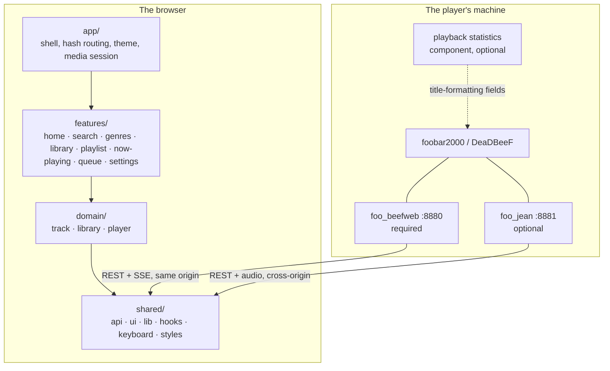
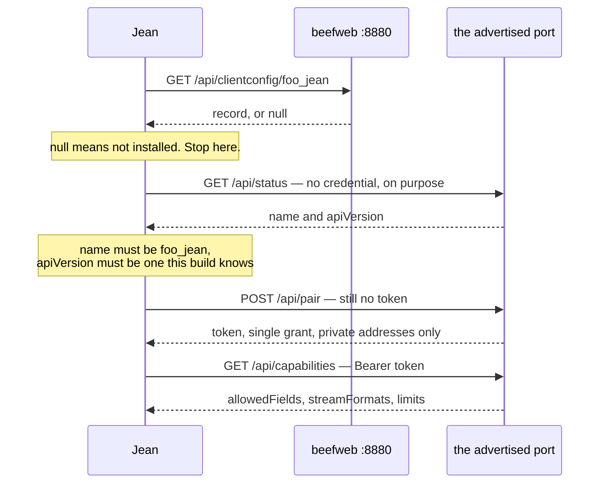

# Architecture

For someone about to build on Jean. Structure, boundaries and contracts: the things a file listing does not tell you. [CONTRIBUTING.md](./CONTRIBUTING.md) is how to write the code; [src/shared/api/README.md](src/shared/api/README.md) is what the player answers.

Jean is a Vite single-page app with no backend of its own. React 19, TypeScript, TanStack Query, TanStack Virtual, TanStack Hotkeys, CSS Modules. Every request it makes is a root-relative `/api/…` path, so the browser resolves it against whatever origin served the page: beefweb in a build, the Vite proxy in development. The one exception is `foo_jean`, which listens on a port of its own.

## The shape of it



Arrows inside the browser are import direction, and they point one way only.

## Tiers

| Tier | Knows about |
|---|---|
| `shared/` | nothing about Jean. The beefweb client and wire types, generic UI, pure helpers, hooks, the keymap, the token layer |
| `domain/` | what Jean is about, as data and behaviour with no route of its own |
| `features/` | one folder per thing a user can do, each owning its own views |
| `app/` | the shell that composes features: `App`, `Sidebar`, `CommandPalette`, theme, hash routing |

**Biome enforces the direction, so a violation fails `pnpm lint`.** `biome.json` carries one `noRestrictedImports` override per tier: `shared/` may not import `@/domain`, `@/features` or `@/app`; `domain/` may not import `@/features` or `@/app`; `features/` may not import `@/app`. Each refusal carries the sentence that says what to do instead.

Within `domain` the slices form a DAG: `library → track → player`. Sideways is allowed; a cycle is not.

Import anything outside its own folder through the `@/` alias. Same-folder imports stay relative.

A file whose home is unclear is usually in the wrong tier. Shared infrastructure is not a feature; a domain concept is not one view of it.

## Where state lives

Two mechanisms, and the split is not arbitrary.

**TanStack Query holds the player's own state**, meaning anything beefweb is the authority on. `usePlayerStream` opens one `EventSource` against `/api/query/updates` and writes each push straight into the cache with `setQueryData`, so the SSE stream is the writer and `useQuery` is only ever a reader.

| Key | Holds | Refreshed by |
|---|---|---|
| `["player"]` | player state and `activeItem` | SSE |
| `["playlists"]` | the playlist list | SSE |
| `["playQueue"]` | the whole queue | SSE |
| `["library","info"]` | `supported` / `enabled` / `itemCount` | window focus. **There is no library event on the stream** |
| `["fooJean", token]` | the discovery result | backoff while retryable, focus otherwise |
| `["fooJeanPlaylists", …]` | which playlists the player fills itself | when beefweb's playlist list changes |
| `["artistInfo", artist]` | MusicBrainz and Wikipedia | never; off unless switched on in Settings |

EventSource reconnects by itself and beefweb replays a full snapshot on connect, so a dropped stream needs no recovery code, but a test that wants to watch it happen needs the fake to hang up on purpose.

**Everything else is a hand-rolled `useSyncExternalStore` store over `src/shared/lib/store.ts`.** That module is the listener half and nothing else: a `Set` of callbacks, `subscribe`, `notify`, `size`. What each store *holds* stays its own business, and there is no shared reducer, no action type and no middleware. `notify()` iterates a copy, since a listener may unsubscribe from inside its own notification and mutating the set mid-iteration would skip its neighbour.

Nine modules build on it: `playlistStore`, `ratingStore`, `listenerStore`, `audience`, `queueClock`, `toastStore`, `dnd`, `keyboardOwner` and `useStoredState`.

**A stored setting is shared by its key, not copied per caller.** `useStoredState` reads through one map and one listener set, so every hook naming a key sees one value and every write. A `useState` per caller makes a live pair out of every key with two readers. Its snapshot returns the same reference until something writes. `useSyncExternalStore` requires that, and a fresh object each call is an infinite render loop rather than a stale value.

Jean's settings live in `localStorage` today and belong in beefweb's `/api/clientconfig/{id}` so they follow the user between devices; the hook's signature is the shape a server-backed version would have, falling back to local storage where `permissions.changeClientConfig` is false. Four keys are permanently excluded from that move, and the exclusion is named next to `TOKEN_KEY` in `src/shared/api/fooJean.ts`: the `foo_jean` token, since beefweb serves the `clientconfig` namespace unauthenticated and syncing a credential would recreate the escalation it exists to prevent, plus the three keys that describe *one device*: its listening volume, its id and its name.

## The library is one array

`src/domain/track/playlistStore.ts` loads the library in chunks and publishes a `PlaylistSnapshot`: `rows` as positional column arrays, `paths` and `subsongs` parallel to them on the media library source, plus derived `heat` and `patina` as `Float32Array`. A view is a set of **refs**, `Int32Array | number[]`, where a ref is a playlist index on one source and a position in the paths array on the other. `project()` turns refs into rows; `refAt()` is the one place that knows a null ref list means "everything, in order".

It is a flat array rather than a tree for three reasons. beefweb answers ranges, not nodes. A ref into a flat array is an integer, so a filtered view is a typed array and a selection is a set of integers. And every screen in Jean is a filter over the same list, whether a shelf, a genre or a search, so a tree would be rebuilt per view and thrown away.

Chunking differs by source, since the two cost different things: a playlist read is almost all round trip, so the first chunk is small enough to paint from and the rest are large and concurrent. The media library endpoint re-enumerates on every call and beefweb serialises requests on one work queue, so concurrency there buys nothing and one large request wins.

**Search folds when the haystack is built, never per keystroke.** `libraryIndex()` keeps one folded haystack per row, keyed by item count so an edited library re-indexes rather than inheriting rows that have moved; a search is then one `includes()`. `fold()` in `src/shared/lib/text.ts` lowercases and strips diacritics, so `babasonicos` finds `Babasónicos`. Fold the query too, or an accented query stops matching the folded index.

**`useLibrary` returns an object literal, so its identity changes every render.** Depend on `library.snapshot`, the store's own object, replaced only when a load publishes. An exhaustive dependency array can be exhaustive and useless, and the linter only checks the first half.

## Capability detection

The player evaluates title-formatting expressions and answers them positionally, which makes the reachable surface far wider than beefweb's own schema. Jean declares a column set once, as name-and-expression pairs, and `fieldTable()` in `src/shared/api/fieldTable.ts` derives both the list sent to the player and the index each name landed at. Written out separately, the day somebody inserts an expression in the middle is the day a row reports its genre as its artist.

**A field that does not exist answers `?`. A field that exists but is empty answers `''`, `0` or `N/A`.** That difference is the whole mechanism: `readValue` maps both to `null` so rows draw correctly either way, while `fieldIsAvailable` asks whether any sampled row answered something other than `?`. Whatever resolves gets its feature; Settings overrides the guess where detection is wrong.

Three limits worth knowing before relying on it:

- **`$meta(x)` cannot be feature-detected.** It answers `''` for a field that does not exist, where `%x%` answers `?`. Probe with `%x%`.
- **DeaDBeeF has no sentinel.** An unknown field answers `''` there, exactly as an empty one does, so every optional field reads as supported and its column arrives empty rather than staying hidden. Detection is the thing that cannot work on DeaDBeeF, and it errs on the side of showing too much.
- **Sparse fields defeat sampling.** Where a field is carried by only part of a library, detect per track, as the Details panel does.

One fact the player may spell two ways gets an *alternative* rather than a branch: `%lastfm_play_count%` is `foo_enhanced_playcount`'s and counts scrobbles across every device, `%play_count%` is `foo_playcount`'s and counts plays on this machine. `alternativeReader` falls through from one to the other, and an index means nothing outside its own table, so the map is applied by the named readers rather than inside `value()`.

## The two seams

`foo_jean` is optional and always will be. Jean works with it absent and lights up tag writing and listening when it is there. Two interfaces make that true, and **nothing outside them may ask which implementation it is holding.**

| Seam | Interface | Implementations |
|---|---|---|
| `src/domain/track/tagWriter.ts` | `{ kind, canWrite, allowedFields, allows, write }` | `NO_WRITER`, `agentWriter` |
| `src/domain/player/listener.ts` | `{ kind, canListen, formats, target }` | `NO_LISTENER`, the agent listener |

Both answer rather than throw. `NO_WRITER.write` resolves to a refusal carrying a message, so a caller renders the same failure path whether the component is missing or the write was declined. If anything outside these files has to branch on `kind`, the seam is in the wrong place.

Both are fed by one discovery, in `src/shared/api/fooJean.ts`, deduped through `src/shared/hooks/useFooJean.ts`. Every caller names one query key, so the second component to mount reads the first one's result rather than probing again.

## The `foo_jean` security model

The component publishes a discovery record at beefweb's `clientconfig` namespace. **That record is writable by anyone who can reach beefweb**: `POST /api/clientconfig/{id}` is a real route, `changeClientConfig` defaults to true, and beefweb ships with no authentication of its own. A forged record can name any port, and the forgery lasts until the component next starts. **So the advertisement is a hint, never a credential target.**



Read the record, prove the port with an unauthenticated call, and only then attach the token. Skipping the middle step hands a credential to whoever forged the record. That leaves the attack needing someone who can already run a listener on the player's machine.

**Pairing is a write, so it obeys the same order.** `discovery.origin` is non-null exactly when the probe succeeded, which makes it the proof a port is safe to post to, so the Pair button renders on `origin` rather than on the state kind, and an unreachable or impostor port never gets one.

**Discovery resolves to eight states and none of them is silence.** The record alone gives *absent* and *not-listening*. The probe adds *unreachable*; *impostor*, meaning something on that port that is not `foo_jean`, which is what a forged record looks like from here and where Jean must say it did not send the token; and *unsupported*, an `apiVersion` this build does not understand. The token gives *no-token*, *unauthorized* and *ready*. The component is installed and working in five of them, and `src/features/settings/TagWriting.tsx` holds one message and one remedy per state.

**Which project owns which setting.** The component's `config.json` holds what the *player owner* decides: port, bind address, the write allowlist. Jean never edits it and there is no route to it. Jean owns the token and, per field, whether to offer the control at all. **Those switches narrow and never widen.** Settings lists exactly the permitted fields and turns them off, never on.

## Sequencing

Jean has more sequential work than a player client suggests. The player renumbers the play queue on every removal; only the first chunk of a library fill may `replace`; `Promise.all` arrives in whatever order the network settles on. `inSequence` in `src/shared/lib/sequence.ts` is the one way to express it.

> **The trap is `void`.** `done.then(() => void run(...))` calls each step in turn and hands `undefined` to `then`, so nothing waits for anything and the sequencing is silently gone. Return the promise.

## The phrase catalogue

Every string a person reads is a key in `src/shared/i18n/en.ts`, resolved by `t()` against whatever language is showing. The catalogue sits in `shared/` for the same reason `tokens.css` does: every tier draws from it, and the import direction only runs one way.

```
src/shared/i18n/
  en.ts            every phrase, flat and sorted. Imports nothing
  message.ts       what a message is, and the types that read its fields off the literal
  locale.ts        the store: which language, what is loaded, and the module-level translate()
  format.ts        memoised Intl constructors, keyed by locale
  useTranslate.ts  the hooks a component uses
  Trans.tsx        a sentence with elements inside it
```

**English is the bundle's, and every other language is the install's.** `en.ts` is compiled in as the fallback layer, so a stock install fetches nothing and a bad file on disk can never break the language Jean falls back to. The build emits it to `dist/locales/en.json` **as the file to copy**, and nothing reads that back.

**Three things decide which languages exist, and they are not the same thing.**

| | Where | Written by |
|---|---|---|
| English | the bundle | `en.ts` |
| Shipped translations | `public/locales/*.json`, copied verbatim into the build; their codes are compiled in through `__SHIPPED_LOCALES__` | the repository |
| Everything else | `locales/<code>.json` beside `index.html`, listed by hand in `locales/custom.json` | whoever installed Jean |

The split is what makes an upgrade safe: copying a new build over an old one replaces the files the build owns and never touches `custom.json`. **Jean writes none of them.** It cannot even enumerate them: beefweb's static server serves no directory index, and `/api/browser/entries` is a 403 for anything outside the player's music directories, so the list has to be stated somewhere.

**A key the loaded file does not carry falls back to English, and a key Jean no longer has is dropped.** A translation degrades phrase by phrase rather than all at once, which is what lets a half-finished one ship and an out-of-date one keep working.

`t()` derives its argument list from the key it is given, so a *runtime* key has to be typed narrower than `Phrase` or every call demands the union of every phrase's fields. `src/shared/i18n/CLAUDE.md` has that and the rest of the local rules.

## Styling and the token layer

CSS Modules, colocated with the component. The only global stylesheets are `src/shared/styles/tokens.css` (the palette and scale, as custom properties) and `base.css`, both pulled in by `global.css`. Re-theming Jean should mean editing custom properties and nothing else.

**A rule in one module that overrides another's must outrank it on specificity, never merely follow it.** Module order in the bundle follows import order, and import sorting can flip two rules of equal specificity.

Anything spatial belongs to a media query rather than a JS breakpoint flag. Animate compositor properties only.

### The `z-index` scale

App-level layers, lowest first. These share the root stacking context, so a new layer has to be placed against this list rather than picked.

| Layer | `z-index` |
|---|---|
| List toolbar (`TrackBrowser`) | 10 |
| Toolbar pill slot | 12 |
| Find-within results (`Finder`) | 20 |
| Anchored menu (`Menu`) | 25 |
| Now-playing screen | 25 |
| Queue panel scrim, compact | 29 |
| Queue panel · volume popover · listen-here popover | 30 |
| Sidebar scrim, compact | 39 |
| Sidebar drawer, compact | 40 |
| Search dropdown | 42 |
| Track info screen · lyrics screen | 45 |
| Toasts · settings backdrop · shortcut sheet backdrop | 50 |
| Command palette backdrop | 60 |
| Action menu and its scrim | 70 |
| Drag ghost | 80 |

The gaps are deliberate. Lyrics sit above the app chrome, the queue panel and the now-playing screen, and deliberately **under** toasts and menus, because a write that failed still has to be able to say so. The drag ghost is above everything, since a drag can start anywhere.

Values of `0`–`5` appear inside `AlbumCard`, `ShelfRow`, `GenreTile`, `TrackPanels`, `QueuePanel` rows, `ActionMenu` pages and the `Sidebar` row being dragged. Those are local to a stacking context their own component establishes and mean nothing outside it. Do not read them against this table.

## Layout and viewport

The shell is a fixed-height flex column rather than a scrolling document. That pins the status bar by construction instead of `position: sticky`, gives the virtualiser the explicit scroll element it needs, and leaves somewhere for safe-area insets to live.

Below the compact breakpoint the sidebar becomes a drawer, menus become sheets, and several components are a *different component* rather than a narrower one. That is why the test suite runs every spec on both a desktop and a mobile project.

## The fake player

`test/fake-api/` is an in-memory foobar2000: portable route tables with no host in them, plus the node sockets that serve them. `demo/sw.ts` hands the same tables a service worker `fetch` event, which is how the live demo runs a whole player in the browser. The seam is `Responder` in `test/fake-api/http.ts`.

Two consequences before adding a route: anything reaching for a socket, a file or a `Buffer` belongs in the host files rather than the route tables, and fixtures are imported rather than read off disk, since one of the two hosts has no filesystem. [test/README.md](./test/README.md) is the rest of it.

## Absences that shape the code

The code says what exists. These are load-bearing gaps anything built on Jean has to account for.

- **No Web Worker and no IndexedDB persistence**, so a cold start re-fetches and re-indexes. Both are requirements for a very large library, not things already done.
- **No folder tree.** The library browses as one flat list. `/library/items/by-path` is documented in `src/shared/api/README.md` for when that changes.
- **Artwork is the whole of the persistence.** `src/shared/ui/artworkCache.ts` keeps a fixed budget of covers in Cache Storage, oldest out first, deliberately not LRU, so everything rotates and a re-tagged cover refreshes on its own eventually. Nothing else Jean holds survives a reload.
- **Reconciling a stale `itemCount` is only partly built.** `usePlaylists` and `useLibraryInfo` refetch on window focus, and the live `playlistItems` tripwire documented in `src/shared/api/README.md` is not wired, so arithmetic that cannot survive being wrong re-reads the count itself.
