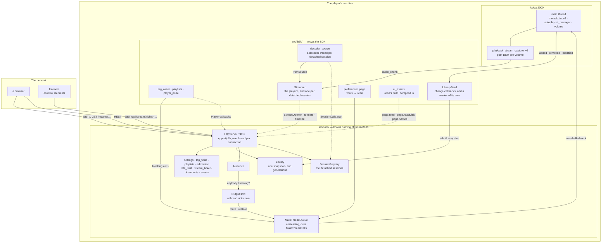
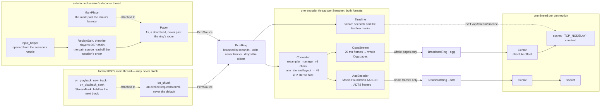

# Architecture

For somebody about to build on this: how the pieces fit, which thread owns what, and why the boundaries sit where they do. [plugins/fb2k/README.md](README.md) is what the component is and how to run it, [plugins/fb2k/CONTRIBUTING.md](CONTRIBUTING.md) is how to write its code, and [src/README.md](src/README.md) is the source tree file by file.

foo_jean is a DLL foobar2000 loads, an HTTP listener on a port of its own, a snapshot of the media library, and a live encode of the player's output and of each detached playback session. It serves Jean's own page as well as its API, so the two share an origin and a client talks to this component alone. It owns the media library, cover art, tag writing, the play queue and every playlist, and it reports what the player is doing. A playlist is listed, read, created, renamed, deleted, reordered, its rows moved and sorted, filled from library ordinals, copied from, cut down and played here, and nowhere else, and every other playback command, transport, seek, the mode and the volume, is answered here too. Every playlist and autoplaylist write is gated behind `writePlaylists`, and an edit addressing one of foo_jean's own playlists is refused whatever that setting says.

## The shape of it

Dotted arrows are the inverted ones: `fb2k/` hands `core/` a set of callbacks, and `core/` never names a foobar2000 type.

## The one boundary

`src/core/` compiles with a C++17 compiler and nothing else: no SDK, no Windows, no player. `src/fb2k/` is everything that touches any of the three. Whatever `core/` needs from the player arrives as a callback or a plain value handed in from `fb2k/`, so the dependency points inward and the player is the detail.

**The build enforces it rather than a reviewer.** `src/foo_jean.vcxproj` compiles every `core/*.cpp` with `PrecompiledHeader=NotUsing`, and the precompiled header is the SDK, so a `core/` file that reaches for an SDK type stops compiling. It is a glob, so a new file inherits the rule without anybody remembering. The rule is not taste: cpp-httplib includes `<winsock2.h>`, the SDK includes `<windows.h>`, and the wrong order is a page of Winsock redefinition errors that name none of it.

What the seam buys is the reason to keep it sharp. The security-critical half, meaning admission, CORS, the write allowlist, config parsing and ticket lifetime, lives in `core/`, so a real `HttpServer` on a real port covers it in a second on any machine. `src/fb2k/` has no coverage at all off the build machine. Put the decision in `core/` and the mechanism in `fb2k/` and that ratio stays good; put a decision in `fb2k/` and it is tested by hand or not at all.

## The seams

Four, all the same shape: `core/` declares what it needs, `fb2k/` supplies it in the component, and `tests/` supplies something else.

| seam | declared in | supplied by | absent means |
|---|---|---|---|
| `Player`, a struct of `std::function`s, one per thing the player can be asked | `core/player.h` | `fb2k/component.cpp`, assembled field by field so two callbacks of the same signature cannot swap silently | that route answers `503`, except `GET /api/track/playing`, which answers `404` |
| `StreamOpener` and `StreamListener` | `core/stream.h` | `fb2k/streamer.cpp` | no streaming, and `canStream` is false |
| `SessionCalls`, the `Player`'s `sessions`: start a detached session's stream, take a playlist's or the library's tracks for it, and read its track, its queue and its cover | `core/player.h` | `start` by `fb2k/decoder_source.cpp`, `takePlaylist` by `fb2k/playlist_reads.cpp`, `takeLibrary` by `fb2k/library.cpp`, `readQueue` by `fb2k/queue.cpp`, `readTrack` and `readArtwork` by `fb2k/session_track.cpp`; `fb2k/component.cpp` wires all six only where the player's own `Streamer` exists | without `start`, `canCreateSessions` is false and `POST /api/sessions` answers `503`; without another, the route asking it of a detached session answers `503`, or `404` for its playing track and cover |
| `logInfo` and `logError` | `core/log.h` | `fb2k/log.cpp`, or `tests/support/log_capture.cpp` | a link error |

Every `Player` callback blocks until foobar2000 has finished or given up, so each belongs on an HTTP worker and never on the main thread. `core/ask_player.h` is how all of them get there. Work the main thread has not started when the wait runs out is dropped; work it has started may still land after its caller has given up. A null callback is not a fault. It is how an install that switched something off says so, and the route answers `503` rather than pretending. `playback.readPlayingTrack` is the one exception: nothing about `GET /api/track/playing` can be switched off the way a library or a stream can, so a null seam there answers `404` instead, the same status the route answers when nothing is playing, following `GET /api/artwork/playing`'s own answer to the same question. Four do not follow the pattern. `library.refresh` returns early: it hands a column set to the snapshot worker and comes straight back, because the client is answered `202` and polls. `library.readArtwork` never reaches the main thread at all: it resolves an address against the snapshot and then talks to foobar2000's album art loader and the filesystem on the connection thread, because a cover is file I/O and the main thread may not wait for one. `library.readTrack` is both: its address resolves against the snapshot on the connection thread the way `library.readArtwork` does, and the caller's columns are compiled on the main thread inside one `askPlayer` job, for the reason `core/player.h`'s `LibraryTrackReader` comment gives, and evaluated back on the connection thread. `library.writeTags` is the one that differs within itself: two of its three address forms resolve against the snapshot on the connection thread and hop to the main thread only to write, while the third resolves inside the writing job, for the reason *Track identity* gives.

The session calls differ again, because a detached session already holds its tracks' handles. `takeLibrary`, `readQueue` and `readArtwork` never reach the main thread. `readTrack` reaches it only to compile the columns a caller asked for, `takePlaylist` copies a playlist's handles in one job, and `start` builds the session's `Streamer` in one, for the reason *Threads, and what may block* gives.

The seven playback and volume commands in `fb2k/playback_commands.cpp`, playing a playlist row among them, follow the plain form of the pattern too: each is one `askPlayer` call run on the main thread, answered once foobar2000 has run the command, with a `504` when it does not finish in time and a `500` when it throws. There is no document to build for a command, and where it landed is `GET /api/state`'s `playback`, `position`, `playbackMode`, `volume` and `muted` to report, not this answer's.

`playback.readPlayingTrack` follows the plain form of the pattern, one `askPlayer` job and nothing on a connection thread, but it has no connection-thread half to skip in the first place: addressed by nothing, it has no snapshot entry to resolve, so finding the playing track, compiling the caller's columns and evaluating them all happen inside that one job on the main thread. What it evaluates the columns against is what sets it apart from `library.readTrack`, which formats off a handle's stored tags: `playback.readPlayingTrack` formats through `playback_control::playback_format_title_ex`, which folds in a station's own live announcement rather than the file's tags, so a station announcing a song answers the song.

`playlists.readRole` is the one whose absence refuses nothing. `POST /playlists/{id}/items` asks it whether the id names one of this component's own playlists before filling, and refuses the fill where the player could not answer; a null `readRole` lets the fill through, which only a test's fake ever leaves, since `fb2k/component.cpp` always wires it.

`HttpServer` takes a `Library*` as well, and that is not a seam. `Library` lives in `core/`, carries its own mutex and is read from a connection thread directly, so wrapping it in callbacks would buy an abstraction with one implementation. Null is how an install with the library switched off says so, and every library route then answers `503` like any other absent capability.

## Playback sessions

Two kinds, and only one is an object here. The engine session is foobar2000's own playback, `playback_control`, under the id `engine`. `SessionRegistry` answers for it without holding it: its state stays foobar2000's, reported through `PlayerStateStore`, its queue is foobar2000's play queue, its audience is the one `HttpServer` is handed, and its `Streamer` is the plugin's. A request naming no session names it, and the route runs the code it would run if there were no other kind. A detached session is a `Session` from `core/session.h`, owned by the registry: its snapshot, queue, order, transport and members are the component's own, and die with the process.

**A detached session plays what it was handed, and the engine session plays what foobar2000 plays.** Playing a playlist or a set of library tracks in a detached session copies their handles once, and the session plays that copy: a later edit to the playlist changes nothing it plays next, and deleting the playlist does not stop it. The engine session follows its playlist as foobar2000 does. A row number stops naming a detached session's track at the playlist's first edit, so a detached session publishes no row for its playing track or for a queued one.

**What is the player's stays the player's, whichever session a request names.** The volume and the mute, the output device and the hold on it, the playlists and autoplaylists, the library and its tags are one each, and every route about them answers the player. `controlPlayback` governs the engine session alone, and `muteWhileStreaming` counts the engine session's listeners alone: each detached session's audience is a `sibling()` of the engine's, with a roster and a wait of its own, so `OutputHold`'s watcher never wakes for it and a listener there never silences the player. A sibling shares the one cap, so `maxConcurrentStreams` bounds stream connections across every session together, since each holds a pooled connection thread whichever session it hears.

## The audio path

**Two sources feed a `Streamer`, and they meet at one seam.** The engine session's audio is captured: `engineCapture()` in `fb2k/streamer.cpp` builds a foobar2000 `playback_stream_capture_v2` callback, which writes each chunk to the ring on the main thread, after the player's DSP chain and before its volume. A detached session decodes for itself: `Decoder` in `fb2k/decoder_source.cpp` is one thread per session, which opens each track from the handle the session holds through the SDK's `input_helper`, scales it by ReplayGain, runs the player's DSP chain over it, and writes what the chain hands back. Each is a `PcmSource` (`core/stream.h`), built by the `Streamer` it feeds and writing into that `Streamer`'s `PcmRing`, and nothing past the ring knows which it was. The encoder thread, `Converter`, both encoders, both broadcast rings, the timeline and every listener's cursor are the same code, and every detached session has a whole `Streamer` of its own. The seam sits at the ring because the capture's whole contribution is one `PcmRing::write`, so a second source costs a second writer and no second pipeline.

**A detached session is made to sound as the engine's capture does.** That capture is post-DSP, so a decoder applies ReplayGain and then the DSP chain before the ring, both on the player's own settings. `fb2k/player_audio_settings.h` holds those settings, kept current by foobar2000's two change notifications, and a decoder copies them between runs of its chain, so a change in Preferences plays from the next block with no restart. The gain source follows the session's order rather than the player's: foobar2000's `query_scale` applies no gain for a source mode that follows the playback order, so `core/session_audio.h` resolves that mode against the session's own order and the decoder hands foobar2000 a plain track or album mode. A chain that throws is dropped for the rest of that session's life, and the session plays on without it. Which flags each run of the chain carries is decided in `core/session_audio.h` too.

**Nothing paces a decoder but `core/pacer.h`.** The capture arrives as fast as the player's output plays it; a decoder has no such clock. The pacer releases its blocks at 1x, `kSessionLead` ahead of what has played, and never into less room than the block needs, since a full `PcmRing` drops its oldest block, which is audio nobody has heard. Asked more than the lead late, it starts its schedule again from now, so a pause, a spell with nobody connected or a stall is not owed back in a burst.

**Neither end ever stalls the player.** A block the main thread cannot hand off is discarded rather than queued, and a listener the writer laps is dropped rather than waited for. A cursor is an absolute byte offset, so how far behind a listener has fallen is a subtraction that no wraparound can confuse.

**The clock advances from each block's own duration**, not from what was encoded, so the engine session's keeps running while nobody is listening. Otherwise every track change during an idle spell would collapse onto one instant. A detached session decodes only while `Session::running()` is true, which needs a connection, and its position runs only then too, so with nobody connected its clock and its position both stand still. A mark travels attached to a block of audio rather than being read separately, and is stamped by the encoder with the stream time of the audio it introduces, so the timeline describes what a listener hears rather than what the player is doing. The engine's is taken on the main thread and rides the next block. A detached session's decoder lays its own, on the block where the track becomes audible, which is later than its first decoded sample by the chain's latency; `core/session_audio.h`'s `MarkPlacer` decides which block that is. Laying a mark calls the `marked` callback its `Streamer` was built with, which bumps the `timelineRevision` of the session it belongs to, `PlayerStateStore`'s for the engine and the `Session`'s own for a detached one, so one session's marks never move another's `ETag`.

**A format nobody is listening to is never encoded**, so an idle player burns no core, and a detached session with no connection decodes nothing either: a linger is not a listener, and decoding through one would play to nobody and start a reconnecting listener further ahead. The two formats fail apart: one encoder giving up closes its own ring, which ends its listeners' responses so they can reconnect, while the other keeps playing rather than going silent for a fault it did not have.

**Ogg needs its header pages before any audio; ADTS is self-describing**, so a listener joins it at any frame. That is the whole difference between the two preambles. The Ogg stream is never restarted at a track change either, because Firefox stops at the first chained boundary. A decoder can only start reading Ogg from a page boundary, never mid-page, which is why encoded output is gathered into whole pages and handed to the ring in one write per block rather than as each page is produced. A listener's cursor starts wherever the ring currently ends, and that position must be one a fresh decoder can begin at.

**Delivery is 1x and a listener never catches up**, so latency added anywhere is paid for as long as anybody listens rather than absorbed. Two defaults charge for it, and both are overridden: libogg gathers a byte count before it emits a page, so a page is cut by duration instead (`OpusStream::kPageSeconds` has why), and cpp-httplib leaves Nagle on, so `set_tcp_nodelay` is mandatory once a page is smaller than a segment.

**A connection ends when cpp-httplib drops its content provider, and not reliably before that.** `Audience::Membership`'s destructor is what a socket closing actually triggers, and `StreamListener::next` returning `false` or the writer lambda returning `false` is what makes that happen. The one other thing told a listener is gone is a detached session: `Session::listen` hands the connection a membership whose release tells the session, and that is how the session counts the connections `Session::running()` reads.

## Threads, and what may block

The thing least visible from any one file.

| thread | owned by | blocks on | must never |
|---|---|---|---|
| the main thread | foobar2000 | nothing | wait for anything this component does |
| one encoder thread per `Streamer`, the engine's and each detached session's | `Streamer` | `PcmRing::read` | let an exception escape, because it is a thread entry point |
| one decoder thread per detached session | `Decoder`, the session's `PcmSource` | `Session::awaitRunning` while the session is not running, `Session::awaitDue` for the pacer, and `input_helper` and the DSP chain | reach the main thread or `playback_control`, or let an exception escape |
| the snapshot worker | `LibraryFeed` | one main-thread hop for `library_manager::get_all_items`, then `metadb_v2::queryMultiParallel`, a slice at a time | hold the main thread for anything past that hop, or let an exception escape |
| the hold's watcher | `OutputHold` | `Audience::awaitChangeFrom`, on the engine session's audience | run where the player's volume callback holds a lock |
| the listener | `HttpServer` | `accept` | outlive `stop()` |
| one per connection | cpp-httplib's pool, `max(8, cores - 1)` at rest and four times that at its ceiling | `BroadcastRing::read`, a `Player` callback, or foobar2000's album art loader and the file under it | outlive `HttpServer::stop()` |

**The pool's base count is `max(8, cores - 1)` and it grows on demand to four times that.** An eight-core player holds up to 32 connection threads, not 8, and queues up to 32 more connections; `connectionPoolFor` in `core/http_server.cpp` sizes both, and one past the queue is closed unanswered.

**The main thread reaches this component from six places**: the capture callback, the two playback callbacks that take a mark, the volume callback, the output config change callback, the preferences page, and every batch `MainThreadQueue` dispatches, which includes the empty check `MainThreadWatch` posts from a state poll to see whether the main thread still answers. None of them may block. `PcmRing::write` drops its oldest block rather than wait, `MainThreadQueue` coalesces a burst of requests into one main-thread callback rather than one each, and `OutputHold::playerVolumeChanged` takes no lock at all: the mute the hold takes lands on the main thread and comes straight back as a volume callback, which against a held lock is a deadlock.

**A decoder thread touches its session, its ring and the player's audio settings, and nothing else of this component.** Its `input_helper`, its chain and the abort that cuts them short are its own, made, run and destroyed on that thread under the COM `fb2k/com_thread.h` holds. Nothing it needs comes from the main thread once it runs: the chain and the ReplayGain settings are copied when the session's stream starts, and a later change arrives through `PlayerAudioSettings`. foobar2000 delivers both change notifications on the main thread (*Facts about the player*) and each decoder reads on its own, so `PlayerAudioSettings` locks. It never calls `playback_control` and never registers a capture, so the engine session's playback and state are out of its reach.

**One main-thread job starts a detached session's stream.** `SessionCalls::start` runs on the connection thread that asked `POST /api/sessions` and blocks on one `askForOutcome` job, which builds the session's `Streamer` and copies the chain and the ReplayGain settings. It is the main thread for the reason `fb2k/decoder_source.cpp` gives: `AacEncoder`'s constructor calls `MFStartup` and `CoCreateInstance` on the constructing thread, so a session's `Streamer` is built where the engine's is. The decoder thread starts only once the job has answered, so a job that timed out leaves nothing decoding. The registry holds no lock while `start` runs, and counts the session against `maxSessions` until it answers.

**Locks nest registry, then session, then audience, and none is held across a start, a stop or a join.** A session never calls the registry. A stop joins the session's decoder and encoder threads, and both call into the session, so a session lock held across one is a deadlock, and a registry lock held across one stalls every route that names a session for the length of the join. So the registry takes a session off its list and refuses it further listeners under its own lock, and stops it after releasing that lock.

**`GET /api/outputs` and `POST /api/outputs/active` both list and switch a device through `askPlayer`**, so `output_manager_v2::listDevices`, `getCoreConfig` and `setCoreConfigDevice` all run on the main thread, and the connection thread that asked either route blocks until it answers, the same shape the playback and volume commands already use.

**A queue move, removal or positioned insert checks its revision twice, and the second check reads the queue itself.** The route reads `PlayerStateStore`'s `queueRevision` on the connection thread before dispatching to the main-thread job. `fb2k/playback_watch.cpp`'s `deferQueueRead` is what moves that revision, queued onto the main thread whenever `playback_queue_callback::on_changed` fires, so a queue change foobar2000 has already made can still be waiting there when the job runs. The job therefore hands the store the queue as foobar2000 holds it before comparing: `queueChanged` moves the revision only when the queue differs, so a read still pending costs nothing when it lands, and the job never proceeds against a queue that has moved further than its revision says.

**Shutdown is `Plugin`'s field order read backwards, with one pair the destructor body governs.** Reverse declaration order would destroy the server before the streamer, and `~HttpServer` joins connection threads that only stopping the stream they read can unblock, so the body stops the engine's `Streamer` and then the server. `HttpServer::stop()` closes the session registry before it stops listening: every detached session refuses another listener, and then its stream stops, which joins its decoder and encoder and ends every response reading from it. None of that may need the main thread, which is the thread running it. `PlayerAudioSettings` is declared before the server, so every decoder reading it is joined before it goes. The fields handle the rest: the volume watch dies before the hold it fires at, the hold before the audience it waits on, the audience before the streamer, and `MainThreadQueue` last, so nothing marshals work onto a queue being torn down.

All of that runs from `on_quit`, on the main thread. That is why `askPlayer` runs its work inline when `MainThreadCalls::isCurrent` says it is already on the main thread: `fb2k::inMainThread` always defers, so queuing from there would wait out the whole timeout for a callback only this thread can dispatch, and the caller that does it is the hold, asking the player to unmute.

**A rebuild in flight makes a quit wait for it.** `~LibraryFeed` joins the snapshot worker, and it runs after the server that reads the snapshot and before the `Library` that holds it. `metadb_v2::queryMultiParallel` takes no abort callback, so the info query goes out in slices rather than as one call over the whole library, and a quit waits out a slice instead of the lot. The rest needs no such handling: sorting is in-memory work with nothing to abort partway, so it runs to completion inside whatever a quit already costs.

**The destructor's first act is `MainThreadQueue::close()`, and it is first for the mirror-image reason.** A request already on a connection thread has marshalled work onto a main thread that is now inside the destructor and will never dispatch it, and `HttpServer::stop()` at the end of the body waits for exactly those requests to finish. So `close()` refuses further work and runs each pending item's `abandon`, settling the answer the caller is blocked on, rather than leaving it to time out. Dropping the work alone would not do: the caller waits on the answer, not on the queue. A stall check still waiting is abandoned the same way, and a state poll after `close()` posts none.

## Track identity, and how a path is spelled

Track identity inside foobar2000 is `%path%` plus `%subsong%`, and no client spells the path. `POST /api/tags` addresses a track for a write by exactly one of three forms. A track the media library holds takes `track`, the library-relative forward-slashed key `GET /api/artwork?track=` takes, with `subsong` for the subsong within the file it names, or `ordinal` with `structure`, a position in the media library snapshot and the generation it was read at. A row the library does not hold takes `playlist`, `index` and `structure`. Naming none of the three, or two of them, is a `400` decided before the player is asked, and the component prefers none: it writes to whichever it was handed.

**A library-relative path can name a track under each of two media library roots, and an ordinal names exactly one.** That is what the ordinal form is for. Two roots holding one relative path put two tracks at one address, and *The media library*'s ordering separates them only by the player's own canonical path, so either would answer. `POST /api/tags` and `GET /api/track/library` refuse such an address rather than take whichever sorts first, which for a cover costs the wrong sleeve and for a write would cost a rating on the other copy, silently and repeatably, with the read-back agreeing.

**Every form resolves to a handle foobar2000 itself produced, and no string from a client becomes a filesystem path.** The two library forms resolve against the snapshot on a connection thread and reach the main thread only to write. The relative-path form is a lookup in the snapshot's own relative-path map, the map *Artwork* describes, and `subsong` is matched by value against the ordinals at that path, which *The media library*'s ordering leaves contiguous and in subsong order; *Facts about the player* has why a position among them is the wrong reading. The ordinal form goes through the same `OrdinalResolver` the fill and queue routes use, which checks the generation against the snapshot it reads under one lock; a later rebuild moves ordinals and not a handle already in hand, so nothing about that check has to be atomic with the write. The positional form reads the handle at its index on the main thread, inside the job that writes: playlist items have no id and any mutation invalidates indices, so it carries the structure generation the client read that position at, and the writing job is the only place that check is atomic with the write. A generation that has moved is a `409` and writes nothing, whichever of the two it is. So nothing refuses an address for its shape, and a media library rooted on a UNC share is as writable as one on a local disk.

Two spellings of a path reach a reader, and they are not interchangeable. `metadb_handle::get_path()` answers the canonical form, which on a portable install is `file-relative://..\Music\x.mp3`, while `filesystem::g_get_display_path` answers an absolute path for the same file, so a client joining one to the other on equality would never match. **Everything published to a client goes through `filesystem::g_get_display_path`**, so anything answering in the other dialect makes the API disagree with itself.

## The media library

Paging a library needs a stable sorted order, and producing one needs a full pass over every track. So either a client holds the whole library or this component does, and it is held here: this is the machine where foobar2000 already keeps the database in memory, and where `library_callback_v2_dynamic` says when it changed. The client is a browser on a phone.

`core/library.h` owns the snapshot, the two generations, what a request may ask for, and the bytes that go on the wire. `fb2k/library.h` owns the walk of the player: the change callbacks, the info query and the title formatting. Nothing in `core/` knows how the rows got there. The worker reports its own progress into `Library` as it walks, so a request arriving mid-build reads that progress off the same object rather than a channel of its own.

**The client declares the columns, and the export request is the declaration.** `GET /api/library/export?columns=…` carries the title-formatting expressions a client wants, and the component evaluates exactly those and interprets none of them, which is what keeps it general and what keeps a client's own `?` detection working. Every later rebuild reuses the last declared set, so `LibraryRefresher` takes columns rather than nothing. One snapshot is held, so a request naming a different set costs a rebuild rather than a slot, and the rate limiter in front of both entry points is what stops a client asking for repeated full rebuilds by varying the set. An export naming the columns already declared, with no build running and the snapshot not holding them, starts one rather than answering against nothing, so a build that died, a walk that timed out on the player's main thread for one, is restarted by the next export rather than waited on forever. Title formatting reads tags and does arithmetic, with no file access and no way to write, so an expression is a compute cost and never an escape: bound the compute and there is nothing left.

Beside the declared columns the snapshot carries a spine it owns, because it needs that to do its own job: `directory` and `filename`, library-relative and forward-slashed, and `subsong`. foobar2000's library root never reaches a client. Directories repeat heavily, so splitting the path in two halves the largest column. **Ordinals are handed out in library-relative path order, and foobar2000 does the comparing.** `fb2k/library.cpp` builds one `fb2k::sortString_t` per track and hands `ordinalOrder` the comparison the player's own `sort_by_relative_path` uses, so a client's view is in the order a playlist the player filled and sorted is in, by construction rather than by luck. `core/` supplies the rest: the tie is broken by subsong and then by the player's own canonical path, because a client's refs are ordinals and an order that is not total shuffles them between rebuilds for nothing. A second comparison living in `core/` could only drift from the first, so there is not one.

### The wire format

One kind of column, so there is no type system to argue about: the distinct values as a dictionary, and one id per row. Where a column's cardinality approaches the row count the dictionary degenerates, since an ids array is the size a packed-text column's offsets would have been anyway.

A body is `JLIB`, a `uint32` header length, a JSON header, then the blob its offsets point into. **Every section starts on a four-byte boundary and every integer in it is little-endian**, because a client takes typed-array views straight over the bytes as they arrived: a typed array over an unaligned offset throws, and every platform a browser runs on is little-endian. An id width is the narrowest of one, two and four bytes that holds the column's dictionary, so a reader takes each width from the header rather than from the column it belongs to.

**Each column carries `distinct`, `hasUnresolved` and `allUnresolved`.** The component holds the whole dictionary, so what a client would otherwise learn by sampling rows for a `?` is a fact it can be handed, and a field that resolves on one track in ten thousand is detected rather than missed.

**These routes run the content negotiation themselves.** cpp-httplib compresses only what `can_compress_content_type` admits, and a snapshot and a delta go out as `application/octet-stream`, which is not on that list; the state document is JSON and would be, but a validator has to name the coding it was taken from whichever route answered. So `core/http_responses.cpp` reads `Accept-Encoding` for all three, drives the same gzip compressor cpp-httplib would have used, and sets `Content-Encoding`, which is also what stops cpp-httplib compressing the result a second time. `CPPHTTPLIB_ZLIB_SUPPORT` is defined in `src/foo_jean.vcxproj` and zlib is vendored under `third_party/zlib/`, for the reason `third_party/README.md` gives.

**A validator names the coding it was taken from**, and every answer carries `Vary: Accept-Encoding`, so a client has to revalidate with the `Accept-Encoding` it first asked with or it gets a `200`. The body is built only once the conditional check has failed, because serialising a library is the expensive half of any of these requests, and `kMaxLibraryBytes` bounds it once it is built and before it is compressed. That ceiling is a response ceiling, which `kMaxBodyBytes` is not: one caps what a route may answer and the other what a request may carry.

### Staleness

Three mechanisms, in descending order of trust, and one promise none of them makes.

**The player says so.** `library_callback_v2_dynamic` delivers added, removed and modified on the main thread, and every tag write arrives as `on_items_modified_v2`: a rating, a lyric written during playback, an edit in foobar2000's own dialog, one this component made itself. `library_callback::is_modified_from_hook()` separates a real tag change from a display-hook refresh, which is how a play-count component announces itself. Both are taken. The distinction is worth a log line and nothing else, and nothing may filter on it. On the main thread the callback does the cheap half, mapping a handle to an ordinal and marking it dirty; the re-query and the formatting happen on the worker. A library import fires thousands of these, so dirty marks accumulate and a rebuild waits for a quiet period.

**Playback is always suspect.** The commonest change of all is a play count going up, and it is the one a component may keep to itself: *Facts about the player* has what `foo_enhanced_playcount` does about that. So a track that stops being the active one is marked dirty whether or not anything said to. One row re-queried per track played buys the play count, the last-played date and a lyric written mid-play, out of a component that never notifies.

**A hand on the wheel.** `POST /api/library/refresh` rebuilds from scratch, rate limited.

**A column declaration and a data change queue a rebuild differently.** `core/library.h`'s `RebuildQueue` keeps at most one pending rebuild of each kind. A request naming the column set already being built drops a rebuild queued only because some other set was asked for, but never one queued because the library changed, which would otherwise leave every client on a stale snapshot until something else moved it. It carries no lock of its own; the worker in `fb2k/library.cpp` drives it under the lock the feed already holds.

**What none of it promises.** A component keeping its data in a private database, publishing it through a title-formatting hook and never touching the metadb, leaves a value stale until that track next plays or somebody refreshes. foobar2000's own playlist columns show the same stale value. `contract/openapi.yaml` says so on the route rather than implying a freshness this cannot deliver.

### Two generations

`structure` moves when tracks are added or removed. Ordinals shift, a client's arrays mean nothing, and it exports again. `revision` moves when a row changes in place. Ordinals hold, so a client asks for a delta and patches what it already has.

They are two because the two kinds of churn are nothing alike. A modification lands once per play, all day. An add or a remove is rare and is something the user just did, so paying for one with a re-download charges it at the moment somebody expects to wait.

**Dictionaries are append-only within a structure generation.** That is what makes a delta small: it carries the entries added since, plus the changed ids, and a client never rebuilds a dictionary it already holds. A value that falls out of use leaves a dead entry behind, and the next structure rebuild compacts it.

**A delta is per column, and it names the columns that moved.** A client keys its derived structures on the identity of a column's array, so one bumped `revision` meaning "something, somewhere" would rebuild the folded search text and the album, artist and genre indices on every track played. Nothing about a play changes a title.

**The retained window is spent by listening rather than by the clock.** A track that stops playing is marked dirty whether or not anything announced it, so `revision` moves about once per track played and stands still while nobody is listening. `kRevisionsPerListeningHour` and `kRetainedListeningHours` in `core/library.h` are the two figures `kRetainedRevisions` is the product of, and sizing it that way is what keeps a phone that slept through a night inside the window rather than re-exporting the whole library over the connection least able to carry it. What one retained revision costs is a changed-ordinal list per column, so the window is bounded in memory by the column count and not by the library size.

Both generations sit under `library` in `GET /api/state`, which is small, ETagged and polled, alongside a `player` section carrying what the player is doing. There is no event stream behind either, for the reason *Absences* gives for there being none anywhere here.

### Artwork

`GET /api/artwork` addresses a cover by a track's library-relative path rather than by an ordinal. An ordinal is only meaningful against a `structure`, so a URL built from one would have to carry the generation and would change whenever a track was added anywhere in the library; a relative path survives a rebuild, a restart and a change of column set. That is what lets a client point every row of a record at one URL and hand persistence, deduplication and revalidation to the browser's own cache, which is the whole reason the route exists.

**The address is a lookup key and it is never joined to anything.** `fb2k/library.cpp` keeps ordinal order and a map from relative path into it, replaced whole by a rebuild and read through a `shared_ptr` so a connection thread never reads what the worker is writing. A hit yields a `metadb_handle` the player itself produced, and everything downstream works from that. Traversal is not filtered, because there is nothing for a client string to escape from.

`GET /api/artwork/playing` answers the same shape for whatever the player has loaded right now, addressed by nothing at all, and `GET /api/artwork/playlists/{id}/{row}` resolves a playlist and a position to a handle the same way `/api/playlists/{id}/items/{index}/play` does, for the row `GET /api/artwork` has no path to address. Both exist because a library-relative path names nothing for a track the library has never indexed, and the positional route refuses a row the library *does* hold a path for, so one address is never two ways to ask for the same cover.

**The player's front cover gives way to the embedded one only when it is a type this component does not publish.** foobar2000's loader can answer an image beside the track ahead of the picture in its tags, so a folder holding a `front.tif` scan answers the scan. `core/artwork.h`'s `publishablePicture` then asks for the picture in the file's own tags, and `GET /api/artwork` and the positional route send that. `GET /api/artwork/playing` does not: its picture arrives on the main thread, and the second read opens a file.

**The validator is the picture.** The `ETag` is a fold of the bytes the route would send, so it moves when and only when the cover does, whether that cover sits in the track's own tags or in an image beside it. The cheaper validator that a `stat` of the source file would make is not available: the player will not say which file a cover came from until it has loaded that cover, for the reason `core/artwork.h` gives. So a `304` costs the resolution and the load, and saves the transfer and the client's redraw.

**A present cover is fresh for months and a missing one for minutes**, `kCoverCacheLifetimeSeconds` and `kMissingCoverCacheLifetimeSeconds` in `core/routes_artwork.cpp`; `contract/openapi.yaml`'s *Artwork* section has the exact figures. Never `no-store`: the client is meant to keep the bytes for as long as the lifetime says. `GET /api/artwork/playing` and the positional route carry no lifetime at all, since the same URL names a different picture once the track or the row does, so both stay `private, no-cache` on every outcome. `must-revalidate` appears on none of these, nor on the library blobs, which carry `private, no-cache` for the same reason: `private` is what keeps a shared cache out of a response meant for one caller, and nothing here needs `must-revalidate` to do that job as well. *Facts about the player* has why a shared cache was the thing to keep out in the first place.

## Serving the page

`core/assets.h` decides what a request for Jean's own page may resolve to; `core/routes_page.cpp` asks it and answers, the same split as *The one boundary* at a smaller scale.

Every page answer carries `guardPage`'s headers: a content security policy, `kPageContentPolicy`, that admits nothing from another origin but the three hosts Jean fetches artist information from and `https://lrclib.net`, where a lyric is searched for, and headers refusing framing, the referrer, a shared opener and the camera, microphone and location.

Vite content-hashes every file it writes under `assets/`, so a rebuild is a new URL rather than a changed file at an old one. A browser that already holds a hashed file can keep it for a year without asking again, because the path itself changes when the file does. `index.html` and a hand-added locale carry no such hash, so they are revalidated on every load: an upgrade must never hide behind a browser's stale copy of the page that names it.

`www/locales/` is the one place under one of Jean's own root names that a file on disk may still answer: `routePage` checks that prefix before it checks for a reserved name, so a hand-added translation lands even though `locales` is itself one of the build's root names. Every other root name, and `api`, stays reserved regardless of what a folder elsewhere in `www/` holds there. `fb2k/` resolves a disk path against the profile directory and refuses one that escapes `www/` through a symlink or a junction; `core/` trusts that guarantee and only ever asks for a path shape it has already checked.

A file compiled into the DLL is sent straight from its resource bytes, never copied, and compressed by the component itself rather than by cpp-httplib, for the reason `core/http_responses.h` gives at `sendLongLived`.

`page.names` is read once at startup and kept as a plain list rather than asked for through a callback: it names the build's own root files, and those never change after the build that produced them.

A bare folder name answers with a 301 to the same name with a trailing slash instead of serving its `index.html` directly, because a browser resolves every relative URL on that page against the path it loaded. Skip the redirect and a relative script or stylesheet in the folder's own page resolves against `/` instead of `/<name>/`.

## The HTTP contract

**`contract/openapi.yaml`, at the repository root, is the contract, and it is hand-written.** There is no framework here to generate one from, and a generated spec would describe the implementation rather than the promise: the descriptions carry the reasoning a client needs, which is the half that matters and the half no generator produces. Clients generate their types from it, so a stale spec is a client that compiles and is wrong. It changes in the same pass as any change to a response shape, a status code or an error string.

Two mechanical checks keep the code and the spec together, and neither can read prose. `tests/api_contract_test.cpp` pins the exact key set of every document the component publishes and drives the stream routes to compare their statuses with the spec's, reading the operation list through `tests/support/spec.h`. `scripts/test.sh` compares the spec's version with `src/core/version.h` before it builds anything.

`core/documents.cpp` builds every published document but the refusals and failures, which `core/failures.cpp` builds with the status each goes under. Every answer of 400 or above carries a JSON `error` string. Bodies are capped at `kMaxBodyBytes`, which the spec documents by that number.

`GET /api/status` says less than a port scan, `GET /api/stream` needs a ticket of its own, and every other route answers whatever `admission` and the switches in `config.json` let it. No route requires or reads a credential of the caller's, so adding one changes nothing about `allowedOrigins`: a new route is bound by the same admission check and the same CORS reflection as every route beside it.

## Admission

`core/admission.h` decides who may reach the component at all, and it runs in `filter()` before CORS, before `OPTIONS`, before the page and before any route, on every path including `/api/status` and `/api/stream`. Two checks, in order: `isPrivateAddress` on the connection's own source address, parsed rather than prefix-matched against RFC 1918, loopback and link-local ranges and their IPv6 equivalents, with a `%zone` stripped first; then `Host` against the allowlist `plugins/fb2k/README.md` gives under `allowedHosts`, rather than one expected value, since a browser sends whatever name loaded the page. Either refusal is `403` before routing, naming the host and `allowedHosts` where `Host` is the reason, JSON under `/api/` and plain text everywhere else. Under `/api/` a third check follows: a request a browser marks `Sec-Fetch-Site: cross-site` or `same-site` is `403` unless its `Origin` is in `allowedOrigins`. Every answer there also carries `Cross-Origin-Resource-Policy: same-origin`, because CORS never governs an `` or an `<audio>`.

**A page whose DNS a rebinding attack has pointed at the player's address still sends the `Host` its own address bar carries**, and that name is the attacker's to choose, never the player's, so it cannot end `.lan`, `.local` or `.home.arpa` (`.home.arpa` is reserved by RFC 8375, and ICANN delegates no dotless name) and is refused by the same rule that refuses any other unlisted name. Narrowing `bindAddress` to `127.0.0.1` closes the same class of attack from the other end, for a deployment that only ever answers its own machine.

Every `POST` under `/api/` needs `Content-Type: application/json` or it is `415`; `DELETE` carries no such rule, since a browser preflights every cross-origin `DELETE` regardless of its headers. `application/json` is not one of the content types the Fetch standard lets a cross-origin request send unannounced, so requiring it forces a preflight on every write a page could otherwise fire blind. CORS reflects no origin by default: `allowedOrigins` is the list of pages granted the same read access as the component's own origin, matched whole and case-insensitively, and empty, the default, means only a page the component itself served can read a response.

**What is accepted rather than solved.** Admission and CORS bind a browser: only a browser is held to the `Host` its address bar carries and to the preflight a `Content-Type` forces. Anything else on the private network sets whatever `Host` and `Content-Type` it likes, so it may do whatever the switches in `config.json` permit, exactly as a person at the player may. A malformed switch takes its default, which for every one of them is on, and the log line naming the key, the value it refused and the default it took is the only sign that happened. Neither is a gap to close later: the boundary this component keeps is the private network a caller sits on, not a credential it carries.

Admission answers who; it answers nothing about how often. A source it has already let through could still make every call it is entitled to make many times a second, so `core/rate_limit.h`'s token buckets sit in front of playlist and queue writes, tag writes, query previews, library rebuilds, artwork reads, track reads and state polls, bounding how fast a client bug turns into a burst of them. Every budgeted route refuses in one order: its switch in `config.json`, then what the request says, then whether the player can serve it at all (`503`), then the budget, then anything that asks the player. So a request the player cannot serve spends no token, and an install that switched a feature off never teaches a client to back off from the ones it kept. `tests/refusal_budget_test.cpp` holds it.

## Facts about the player

What foobar2000, its SDK and the platforms under it do that more than one file here depends on. A source comment points at this section in a clause rather than restating an entry.

- **An autoplaylist ignores rows inserted into it without saying so**, so a copy that landed and one that did not look the same from the call alone. `POST /playlists/{id}/items/copy` answers a document naming what changed, so a client needs no item count read either side of it.
- **Starting a row does not decide where the track after it comes from.** Under foobar2000's *Playback follows cursor*, `playlist_execute_default_action` plays the row it was handed, and every advance after it walks the *active* playlist, the one focused in the player's own window. `set_playing_playlist` changes none of that on foobar2000 2.25.3. `fb2k/playback_commands.cpp` activates the playlist first, which moves the visible tab at the player, and `PlayerState`'s `currentPlaylistId` reports the active playlist rather than the playing one.
- **`foo_enhanced_playcount` writes a local play and tells nobody.** It stores through `metadb_index_manager::set_user_data`, and its `dispatch_refresh` calls sit only on last.fm and context-menu paths, so a play count reaches no metadb or playlist callback. The track that stops playing is marked dirty regardless, in the library snapshot by `fb2k/library.cpp` and in its playlist's revision by `PlaylistVersions`.
- **foobar2000 does not compare paths byte by byte.** `sort_by_relative_path` sorts through `fb2k::sortStringCompare`, on Windows `StrCmpLogicalW` with a `wcscmp` tiebreak: a run of digits compares as a number, letters compare case-insensitively, an accent folds to its base letter, and `-` and `'` weigh almost nothing. `2 Mello` comes before `10cc`, and `Andrés` before `Andrew`. Call it rather than model it, on the path as `get_relative_path` wrote it, since `/` and `\` do not weigh the same.
- **foobar2000 numbers a cue sheet's subsongs from 1**, and an ordinary file is subsong 0. A subsong is a value the player assigned rather than a position among the tracks at one path, so anything resolving one by counting is off by one across a cue sheet. The player splits a file on a `CUESHEET` Vorbis comment; the binary `CUESHEET` metadata block alone leaves it one track, and a `.cue` file beside the music is not indexed at all.
- **One compiled title-format script runs on many threads at once.** The SDK's own `sort_by_format_get_order_v3` shares one `titleformat_object` across its workers, with only the hook and the output string per thread, and the one `assert_main_thread` in title-formatting code guards `titleformat_object_cache`'s lazy compile rather than `run()`. Scripts are compiled through `titleformat_compiler` on the main thread anyway, once per build.
- **foobar2000 has no mute flag.** `playback_control`'s volume is dB against full scale, `0` the ceiling and `volume_mute` the floor, and `is_muted()` is `get_volume() == volume_mute`. A mute is a volume everybody sees, so `OutputHold` is the only place that tells the user's mute from this component's own. It never takes back a mute it has seen undone, and when the last listener stops it restores the level from the start of the episode. A mute goes through `volume_mute_toggle()`, or the player's own unmute button restores a stale level. `POST /api/volume` calls `playback_control` directly, so `PlayerVolumeWatch` sees its write through `on_volume_change` like one made at the player, and the route never touches `OutputHold`.
- **`playlist_reorder_items` takes a whole permutation, and the SDK has no call that moves some rows.** `playlist_lock::filter_reorder` refuses a move and a sort alike, whichever call reaches the playlist.
- **`sort_by_format_get_order` is stable, and answers `order[new] = old`**, the shape `playlist_reorder_items` takes. A sort keeps the order of rows whose pattern compares equal, and the same array is what a client needs to follow its rows.
- **The SDK cannot read an autoplaylist's query back.** `autoplaylist_manager` has no call that answers one, and `get_configuration` is the client's own serialisation, read only by its own factory. So the component keeps a record of the autoplaylists it made, and a query it did not write is unreadable.
- **A `SORT BY` or `SORT DESCENDING BY` at the end of an autoplaylist's query is applied by the core's autoplaylist client**, in foobar2000's own collation, which ignores case and accents. It gives the order a `sort` with `forceSort` gives.
- **A `std::chrono::steady_clock::time_point` means nothing off the machine that took it.** `PlayerState.position` and the stream timeline hand a client the age since the mark instead, which the client adds to the mark's value and advances itself.
- **The SDK has no per-playlist subscription.** A `playlist_callback_impl_base` hears about every playlist, so one that cares about a single playlist compares and returns by hand.
- **`on_items_modified` fires once per loaded playlist holding a track whose tags changed, with that playlist's own position mask.** On foobar2000 2.25.10 that holds for a write through this component and for a file retagged outside the player with folder monitoring on. foobar2000 loads a playlist's contents on demand, so one nothing has read since the process started raises nothing. A content revision per playlist stays honest regardless: a client can only be stale about rows it holds, and asking for them loaded the playlist through `playlist_get_items`.
- **foobar2000 keeps a queued entry whose row is removed or whose whole playlist is deleted**, and marks whichever position no longer names anything as infinite. On foobar2000 2.25.10 such an entry still plays when it reaches the head. Read as an index, the infinite value crashes the player, so an entry is read through its handle.
- **Captured samples exceed full scale.** Peaks above +1 dBFS are routine on modern masters, so nothing in the audio path may assume `[-1, 1]`.
- **A decode through the SDK's `input_helper` reproduces foobar2000's own playback to the sample.** On foobar2000 2.25.10, a track's handle opened with `input_flag_playback`, scaled by `t_replaygain_config::query_scale` on the core's ReplayGain settings and run through the core's chain in a `dsp_manager` built with `dsp_entry::flag_playback`, matched `playback_stream_capture_v2`'s output sample for sample, through a stateful limiter and a 48 to 44.1 kHz resample, with the chain's latency landing alike on both sides. Two files cut from one FLAC at a sample off any frame boundary rejoined to the sample when decoded one after the other into one chain, with `END_OF_TRACK` and no flush between them, both through that chain and through none.
- **A decode through `input_helper` reaches no `play_callback` and no `playback_statistics_collector`.** On foobar2000 2.25.10 a track decoded to its end that way moved none of `play_callback`'s counters and no `on_item_played`, while the engine playing the same track moved `on_playback_starting`, `on_playback_new_track`, `on_playback_time`, `on_playback_stop` and `on_item_played`. A component that counts or scrobbles plays hears the engine's and none of a detached session's.
- **Under ReplayGain's source mode by playback order, foobar2000 takes the gain from the order, and `query_scale` handed that mode unresolved applies none.** On foobar2000 2.25.10 the engine applied album gain under Default, Repeat (playlist), Shuffle (albums) and Shuffle (folders), and track gain under Repeat (track), Random and Shuffle (tracks), each matching its explicit mode to 0.000 dB. A decode outside `playback_control` resolves the mode against its own order before calling `t_replaygain_config::query_scale`.
- **foobar2000 delivers the DSP chain's and ReplayGain's change notifications on the main thread, inside the call that caused them.** On foobar2000 2.25.10 every `dsp_config_callback::on_core_settings_change` and every `replaygain_core_settings_notify::on_changed` arrived on the main thread within the `set_core_settings` call that made the change. The SDK does not say which thread it uses.
- **`input_helper::open` throws for a file it cannot open, and a file damaged after its header does not throw at all.** On foobar2000 2.25.10 it throws "Unsupported format or corrupted file" for a file no input takes and "Object not found" for one deleted since it was listed. A FLAC whose frames are garbage past its header, or one cut short, opens, and `input_helper::run` ends it early with no throw, so it reads as a short track.
- **Raising the `abort_callback` handed to `input_helper` or `dsp_manager` makes whichever `run` is in progress throw "User abort"**, on foobar2000 2.25.10, so a decoder stopped that way meets a throw that does not mean the track failed.
- **Under the Crossfader, foobar2000 announces the next track where its fade-in starts.** On foobar2000 2.25.10 the engine's mark for the next track, taken at `on_playback_new_track`, landed 0.97 s before the old track ended, at position 0.098 in the new one. A decoder running the same DSP reaches the next track at the old track's end, so the two kinds of session mark one crossfade a second apart.
- **With no active Windows audio endpoint, foobar2000 still lists a default device, and on it answers play and stays stopped.** On foobar2000 2.25.10 it listed one default device, shared and exclusive, beside the Null Output; a play on the shared one was answered and playback stayed stopped. That device is not the Null Output, so `outputSilent` reads `false` for it.
- **Under Wine, foobar2000 loads Wine's own `msvcp140.dll` rather than the Microsoft copy beside `foobar2000.exe`.** Against it, a `std::future::wait_for` built with VS 2022 17.14 runs its full timeout even once answered, so every request that waits on the main thread fails. The C++ runtime is linked statically for that reason, `/MT` in `Directory.Build.targets`, and `scripts/build.ps1` refuses a DLL that imports one.
- **`album_art.h:231` promises `now_playing_album_art_notify` is never called without a cover, and foobar2000 2.25.3 breaks it**: skipping tracks twice in quick succession calls `on_album_art` with a null `album_art_data::ptr`, so a caller checks the pointer. For a track that has no cover the callback is simply not called, so a store fed only by it keeps the last picture until whatever watches playback clears it on a track change.
- **Safari cannot play Opus before 18.4**, which is why the AAC path exists. **An HTML `<audio>` element issues a plain GET with no custom body and no custom header**, and probes a source with `Range: bytes=0-1` before it plays, so one listening device routinely counts as two connections and the stream response denies ranges. A stream ticket is minted over a request a script controls and carries the device's identity into the `<audio>` element's GET in the URL, the one place that GET can carry it.
- **A browser hands cross-origin script only the CORS-safelisted response headers**: `Cache-Control`, `Content-Language`, `Content-Length`, `Content-Type`, `Expires`, `Last-Modified`, `Pragma`. `ETag` and `Retry-After` need naming in `Access-Control-Expose-Headers`. `If-None-Match` is not on the request side's safelist either, so it needs naming in `Access-Control-Allow-Headers`, or a page can read a validator and never send one back.
- **A browser stores a `private` response and revalidates it correctly, under `no-cache` or a lifetime.** Chromium, Gecko and WebKit all store a cover marked `private`, revalidate it with `If-None-Match` where `Cache-Control` says to, and reuse it unconditionally within its `max-age`, across a browser restart and cross-origin alike. A `private` directive already forbids a shared cache from storing the response (RFC 9111 §5.2.2.7), the narrower rule `must-revalidate` would otherwise approximate (RFC 9111 §3.5), so no route here needs `must-revalidate`.
- **A route publishing images MUST never send `image/svg+xml`.** Besides being a document a browser executes, it is the one image type cpp-httplib's own compression would reach; `third_party/README.md` has what that compressor admits and why the content type is the whole of the gate.

## Absences that shape the design

The code says what is there. These are the gaps to design back into rather than fill.

- **No event stream.** cpp-httplib is thread-per-connection, so a subscription would cost a thread for as long as a client held it. A client polls `GET /api/state` instead, and its `playlistsRevision` says when to read `GET /api/playlists` again. Streaming is the one thing worth a held thread, which is exactly what `maxConcurrentStreams` bounds.
- **No second copy of anything the player answers cheaply.** For tags and playlists this component is a messenger: accept a request, hand the work to foobar2000, answer, and hold nothing between one request and the next. A copy of a playlist would be wrong the moment somebody edited it in the player, and there is nothing to win by keeping one. The media library is the exception, and it is a snapshot rather than a cache: what makes it safe to hold is that `library_callback_v2_dynamic` says when the library changed, so nothing here has to guess whether what it holds is still true. *The media library* is what that costs. A detached session's snapshot is not such a copy: it is the handles of the tracks the session was asked to play, kept as handed and never compared with the playlist again (*Playback sessions*).
- **No library scan.** Nothing here walks a directory. Paths arrive from a client and are resolved against what the player reports, and `preview` counts a query through the core's own library index rather than reading anything off disk.
- **No second abstraction behind the boundary.** One architectural seam is enough. `core/` has no plugin registry, no strategy interface with a single implementation, and no layer between a route and the pure function it calls.
- **No per-request bitrate, and no seeking a listener's own stream.** One encoder per format per session feeds every listener of it; a second bitrate would mean a second encoder and a second buffer for as long as anybody held it. A seek moves the session, foobar2000's own playback or a detached session's, and with it every listener of that session at once.
- **No route that takes the output hold.** A client may ask for the player to be audible alongside the listeners. When they should be one output again is this component's decision, and it makes it afresh once everybody has stopped listening.
