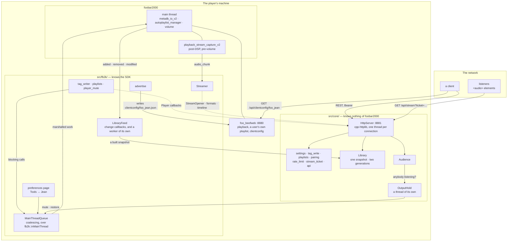
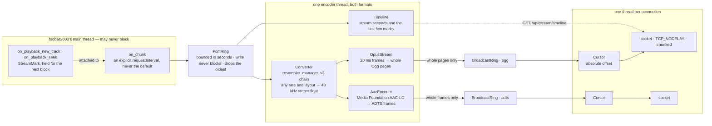

# Architecture

For somebody about to build on this: how the pieces fit, which thread owns what, and why the boundaries sit where they do. [plugins/fb2k/README.md](README.md) is what the component is and how to run it, [plugins/fb2k/CONTRIBUTING.md](CONTRIBUTING.md) is how to write its code, and [src/README.md](src/README.md) is the source tree file by file.

foo_jean is a DLL foobar2000 loads, an HTTP listener on a port of its own, a snapshot of the media library, and one live encode of the player's output. It owns the media library, cover art, tag writing, the play queue and every playlist, and it reports what the player is doing. A playlist is listed, read, created, renamed, deleted, reordered, filled from library ordinals, copied from, cut down and played here, and nowhere else. What is left to beefweb is the playback commands beyond starting a row, browsing the filesystem, and serving a client its own page. Every playlist and autoplaylist write is gated behind `writePlaylists`, and an edit addressing one of foo_jean's own playlists is refused whatever that setting says. A client talks to both.

## The shape of it

Dotted arrows are the inverted ones: `fb2k/` hands `core/` a set of callbacks, and `core/` never names a foobar2000 type.

## The one boundary

`src/core/` compiles with a C++17 compiler and nothing else: no SDK, no Windows, no player. `src/fb2k/` is everything that touches any of the three. Whatever `core/` needs from the player arrives as a callback or a plain value handed in from `fb2k/`, so the dependency points inward and the player is the detail.

**The build enforces it rather than a reviewer.** `src/foo_jean.vcxproj` compiles every `core/*.cpp` with `PrecompiledHeader=NotUsing`, and the precompiled header is the SDK, so a `core/` file that reaches for an SDK type stops compiling. It is a glob, so a new file inherits the rule without anybody remembering. The rule is not taste: cpp-httplib includes `<winsock2.h>`, the SDK includes `<windows.h>`, and the wrong order is a page of Winsock redefinition errors that name none of it.

What the seam buys is the reason to keep it sharp. The security-critical half, meaning the bearer check, CORS, the write allowlist, config parsing, ticket lifetime and the pairing rules, lives in `core/`, so a real `HttpServer` on a real port covers it in a second on any machine. `src/fb2k/` has no coverage at all off the build machine. Put the decision in `core/` and the mechanism in `fb2k/` and that ratio stays good; put a decision in `fb2k/` and it is tested by hand or not at all.

## The seams

Three, all the same shape: `core/` declares what it needs, `fb2k/` supplies it in the component, and `tests/` supplies something else.

| seam | declared in | supplied by | absent means |
|---|---|---|---|
| `Player`, a struct of `std::function`s, one per thing the player can be asked | `core/http_server.h` | `fb2k/component.cpp`, assembled field by field so two callbacks of the same signature cannot swap silently | that route answers `503` |
| `StreamOpener` and `StreamSession` | `core/stream.h` | `fb2k/streamer.cpp` | no streaming, and `canStream` is false |
| `logInfo` and `logError` | `core/log.h` | `fb2k/log.cpp`, or `tests/support/log_capture.cpp` | a link error |

Every `Player` callback blocks until foobar2000 has finished or given up, so each belongs on an HTTP worker and never on the main thread. `fb2k/ask_player.h` is how all of them get there. A null callback is not a fault. It is how an install that switched something off says so, and the route answers `503` rather than pretending. Two do not follow the pattern. `refreshLibrary` returns early: it hands a column set to the snapshot worker and comes straight back, because the client is answered `202` and polls. `readArtwork` never reaches the main thread at all: it resolves an address against the snapshot and then talks to foobar2000's album art loader and the filesystem on the connection thread, because a cover is file I/O and the main thread may not wait for one.

`HttpServer` takes a `Library*` as well, and that is not a fourth seam. `Library` lives in `core/`, carries its own mutex and is read from a connection thread directly, so wrapping it in callbacks would buy an abstraction with one implementation. Null is how an install with the library switched off says so, and every library route then answers `503` like any other absent capability.

## The audio path

**Neither end ever stalls the player.** A block the main thread cannot hand off is discarded rather than queued, and a listener the writer laps is dropped rather than waited for. A cursor is an absolute byte offset, so how far behind a listener has fallen is a subtraction that no wraparound can confuse.

**The clock advances from each block's own duration**, not from what was encoded, so it keeps running while nobody is listening. Otherwise every track change during an idle spell would collapse onto one instant. A mark is taken on the main thread, travels attached to the next block of audio rather than being read separately, and is stamped by the encoder with the stream time of the audio it introduces, so the timeline describes what a listener hears rather than what the player is doing.

**A format nobody is listening to is never encoded**, so an idle player burns no core, and the two formats fail apart: one encoder giving up closes its own ring, which ends its listeners' responses so they can reconnect, while the other keeps playing rather than going silent for a fault it did not have.

**Ogg needs its header pages before any audio; ADTS is self-describing**, so a listener joins it at any frame. That is the whole difference between the two preambles. The Ogg stream is never restarted at a track change either, because Firefox stops at the first chained boundary. A decoder can only start reading Ogg from a page boundary, never mid-page, which is why encoded output is gathered into whole pages and handed to the ring in one write per block rather than as each page is produced. A listener's cursor starts wherever the ring currently ends, and that position must be one a fresh decoder can begin at.

**Delivery is 1x and a listener never catches up**, so latency added anywhere is paid for the whole session rather than absorbed. Two defaults charge for it, and both are overridden: libogg gathers a byte count before it emits a page, so pages are built to a duration derived from the bitrate instead (`core/opus_stream.h` has the floor and why it exists), and cpp-httplib leaves Nagle on, so `set_tcp_nodelay` is mandatory once a page is smaller than a segment.

**A connection ends when cpp-httplib drops its content provider, and not reliably before that.** `Audience::Membership`'s destructor is what a socket closing actually triggers, and `StreamSession::next` returning `false` or the writer lambda returning `false` is what makes that happen; nothing else in this component is told a listener is gone.

## Threads, and what may block

The thing least visible from any one file.

| thread | owned by | blocks on | must never |
|---|---|---|---|
| the main thread | foobar2000 | nothing | wait for anything this component does |
| one encoder thread | `Streamer` | `PcmRing::read` | let an exception escape, because it is a thread entry point |
| the snapshot worker | `LibraryFeed` | one main-thread hop for `library_manager::get_all_items`, then `metadb_v2::queryMultiParallel`, a slice at a time | hold the main thread for anything past that hop, or let an exception escape |
| the hold's watcher | `OutputHold` | `Audience::awaitChangeFrom` | run where the player's volume callback holds a lock |
| the listener | `HttpServer` | `accept` | outlive `stop()` |
| one per connection | cpp-httplib's pool, `max(8, cores - 1)` at rest and four times that at its ceiling | `BroadcastRing::read`, a `Player` callback, or foobar2000's album art loader and the file under it | outlive `HttpServer::stop()` |

**The pool's base count is `max(8, cores - 1)` and it grows on demand to four times that.** An eight-core player holds up to 32 connection threads, not 8. Past that ceiling a new connection is not refused: cpp-httplib's job queue has no bound by default, so the request waits there for a thread rather than being served or turned away.

**The main thread reaches this component from five places**: the capture callback, the two playback callbacks that take a mark, the volume callback, the preferences page, and every batch `MainThreadQueue` dispatches. None of them may block. `PcmRing::write` drops its oldest block rather than wait, `MainThreadQueue` coalesces a burst of requests into one main-thread callback rather than one each, and `OutputHold::playerVolumeChanged` takes no lock at all: the mute the hold takes lands on the main thread and comes straight back as a volume callback, which against a held lock is a deadlock.

**A queue move, removal or positioned insert checks its revision twice, and the gap between the two checks is not fully closed.** The route reads `PlayerStateStore`'s `queueRevision` on the connection thread before dispatching to the main-thread job, which reads it again immediately before touching the queue. `fb2k/playback_watch.cpp`'s `deferQueueRead` is what moves that revision, queued onto the main thread whenever `playback_queue_callback::on_changed` fires, so a queue change foobar2000 has already made can still be waiting there when the job's own check runs. That second check catches a deferred read that has already landed; one still pending has not, and the job proceeds against a queue that has moved further than its own revision says.

**Shutdown is `Plugin`'s field order read backwards, with one pair the destructor body governs.** Reverse declaration order would destroy the server before the streamer, and `~HttpServer` joins connection threads that only `Streamer::stop()` can unblock, so the body stops the streamer and then the server. The fields handle the rest: the volume watch dies before the hold it fires at, the hold before the audience it waits on, the audience before the streamer, and `MainThreadQueue` last, so nothing marshals work onto a queue being torn down.

All of that runs from `on_quit`, on the main thread. That is why `askPlayer` runs its work inline when it is already on the main thread: `fb2k::inMainThread` always defers, so queuing from there would wait out the whole timeout for a callback only this thread can dispatch, and the caller that does it is the hold, asking the player to unmute.

**A rebuild in flight makes a quit wait for it.** `~LibraryFeed` joins the snapshot worker, and it runs after the server that reads the snapshot and before the `Library` that holds it. `metadb_v2::queryMultiParallel` takes no abort callback, so the info query goes out in slices rather than as one call over the whole library, and a quit waits out a slice instead of the lot. The rest needs no such handling: sorting is in-memory work with nothing to abort partway, so it runs to completion inside whatever a quit already costs.

**The destructor's first act is `MainThreadQueue::close()`, and it is first for the mirror-image reason.** A request already on a connection thread has marshalled work onto a main thread that is now inside the destructor and will never dispatch it, and `HttpServer::stop()` at the end of the body waits for exactly those requests to finish. So `close()` refuses further work and runs each pending item's `abandon`, settling the answer the caller is blocked on, rather than leaving it to time out. Dropping the work alone would not do: the caller waits on the answer, not on the queue.

## Track identity, and two spellings of a path

Track identity is `%path%` plus `%subsong%`. Playlist items have no id, and any mutation invalidates indices, so every route addresses a track by path.

There are two spellings of that path and they are not interchangeable. `metadb_handle::get_path()` answers the canonical form, which on a portable install is `file-relative://..\Music\x.mp3` where beefweb answers an absolute path for the same file, so a client joining the two on equality would never match. **Everything published to a client goes through `filesystem::g_get_display_path`**, and `POST /api/tags` accepts the display form, so anything answering in the other dialect makes the API disagree with itself.

`metadb::handle_create` will build a handle for any path at all, so being on the write allowlist is not being a track the player manages. The check that the player already knows the track, through the Media Library or an open playlist since plenty of installs have no library configured, is what stands between an allowlisted field and a file foobar2000 has never seen.

## The media library

Paging a library needs a stable sorted order, and producing one needs a full pass over every track. So either a client holds the whole library or this component does, and it is held here: this is the machine where foobar2000 already keeps the database in memory, and where `library_callback_v2_dynamic` says when it changed. The client is a browser on a phone.

`core/library.h` owns the snapshot, the two generations, what a request may ask for, and the bytes that go on the wire. `fb2k/library.h` owns the walk of the player: the change callbacks, the info query and the title formatting. Nothing in `core/` knows how the rows got there.

**The client declares the columns, and the export request is the declaration.** `GET /api/library/export?columns=…` carries the title-formatting expressions a client wants, and the component evaluates exactly those and interprets none of them, which is what keeps it general and what keeps a client's own `?` detection working. Every later rebuild reuses the last declared set, so `LibraryRefresher` takes columns rather than nothing. One snapshot is held, so a request naming a different set costs a rebuild rather than a slot, and the rate limiter in front of both entry points is what stops a client asking for repeated full rebuilds by varying the set. Title formatting reads tags and does arithmetic, with no file access and no way to write, so an expression is a compute cost and never an escape: bound the compute and there is nothing left.

Beside the declared columns the snapshot carries a spine it owns, because it needs that to do its own job: `directory` and `filename`, library-relative and forward-slashed, and `subsong`. foobar2000's library root never reaches a client. Directories repeat heavily, so splitting the path in two halves the largest column. **Ordinals are handed out in library-relative path order, and foobar2000 does the comparing.** `fb2k/library.cpp` builds one `fb2k::sortString_t` per track and hands `ordinalOrder` the comparison the player's own `sort_by_relative_path` uses, so a client's view is in the order a playlist the player filled and sorted is in, by construction rather than by luck. `core/` supplies the rest: the tie is broken by subsong and then by the player's own canonical path, because a client's refs are ordinals and an order that is not total shuffles them between rebuilds for nothing. A second comparison living in `core/` could only drift from the first, so there is not one.

### The wire format

One kind of column, so there is no type system to argue about: the distinct values as a dictionary, and one id per row. Where a column's cardinality approaches the row count the dictionary degenerates, since an ids array is the size a packed-text column's offsets would have been anyway.

A body is `JLIB`, a `uint32` header length, a JSON header, then the blob its offsets point into. **Every section starts on a four-byte boundary and every integer in it is little-endian**, because a client takes typed-array views straight over the bytes as they arrived: a typed array over an unaligned offset throws, and every platform a browser runs on is little-endian. An id width is the narrowest of one, two and four bytes that holds the column's dictionary, so a reader takes each width from the header rather than from the column it belongs to.

**Each column carries `distinct`, `hasUnresolved` and `allUnresolved`.** The component holds the whole dictionary, so what a client would otherwise learn by sampling rows for a `?` is a fact it can be handed, and a field that resolves on one track in ten thousand is detected rather than missed.

**These routes run the content negotiation themselves.** cpp-httplib compresses only what `can_compress_content_type` admits, and a snapshot and a delta go out as `application/octet-stream`, which is not on that list; the state document is JSON and would be, but a validator has to name the coding it was taken from whichever route answered. So `core/http_server.cpp` reads `Accept-Encoding` for all three, drives the same gzip compressor cpp-httplib would have used, and sets `Content-Encoding`, which is also what stops cpp-httplib compressing the result a second time. `CPPHTTPLIB_ZLIB_SUPPORT` is defined in `src/foo_jean.vcxproj` and zlib is vendored under `third_party/zlib/`, for the reason `third_party/README.md` gives.

**A validator names the coding it was taken from**, and every answer carries `Vary: Accept-Encoding`, so a client has to revalidate with the `Accept-Encoding` it first asked with or it gets a `200`. The body is built only once the conditional check has failed, because serialising a library is the expensive half of any of these requests, and `kMaxLibraryBytes` bounds it once it is built and before it is compressed. That ceiling is a response ceiling, which `kMaxBodyBytes` is not: one caps what a route may answer and the other what a request may carry.

### Staleness

Three mechanisms, in descending order of trust, and one promise none of them makes.

**The player says so.** `library_callback_v2_dynamic` delivers added, removed and modified on the main thread, and every tag write arrives as `on_items_modified_v2`: a rating, a lyric written during playback, an edit in foobar2000's own dialog, one this component made itself. `library_callback::is_modified_from_hook()` separates a real tag change from a display-hook refresh, which is how a play-count component announces itself. Both are taken. The distinction is worth a log line and nothing else, and nothing may filter on it. On the main thread the callback does the cheap half, mapping a handle to an ordinal and marking it dirty; the re-query and the formatting happen on the worker. A library import fires thousands of these, so dirty marks accumulate and a rebuild waits for a quiet period.

**Playback is always suspect.** The commonest change of all is a play count going up, and it is the one a component may keep to itself: *Facts about the player* has what `foo_enhanced_playcount` does about that. So a track that stops being the active one is marked dirty whether or not anything said to. One row re-queried per track played buys the play count, the last-played date and a lyric written mid-play, out of a component that never notifies.

**A hand on the wheel.** `POST /api/library/refresh` rebuilds from scratch, rate limited.

**A column declaration and a data change queue a rebuild differently.** `core/library.h`'s `RebuildQueue` keeps at most one pending rebuild of each kind. A request naming the column set already being built drops a rebuild queued only because some other set was asked for, but never one queued because the library changed, which would otherwise leave every client on a stale snapshot until something else moved it. It carries no lock of its own; the worker in `fb2k/library.cpp` drives it under the lock the feed already holds.

**What none of it promises.** A component keeping its data in a private database, publishing it through a title-formatting hook and never touching the metadb, leaves a value stale until that track next plays or somebody refreshes. foobar2000's own playlist columns show the same stale value. `contract/openapi.yaml` says so on the route rather than implying a freshness this cannot deliver.

### Two generations

`structure` moves when tracks are added or removed. Ordinals shift, a client's arrays mean nothing, and it exports again. `revision` moves when a row changes in place. Ordinals hold, so a client asks for a delta and patches what it already has.

They are two because the two kinds of churn are nothing alike. A modification lands once per play, all day. An add or a remove is rare and is something the user just did, so paying for one with a re-download charges it at the moment somebody expects to wait.

**Dictionaries are append-only within a structure generation.** That is what makes a delta small: it carries the entries added since, plus the changed ids, and a client never rebuilds a dictionary it already holds. A value that falls out of use leaves a dead entry behind, and the next structure rebuild compacts it.

**A delta is per column, and it names the columns that moved.** A client keys its derived structures on the identity of a column's array, so one bumped `revision` meaning "something, somewhere" would rebuild the folded search text and the album, artist and genre indices on every track played. Nothing about a play changes a title.

**The retained window is spent by listening rather than by the clock.** A track that stops playing is marked dirty whether or not anything announced it, so `revision` moves about once per track played and stands still while nobody is listening. `kRevisionsPerListeningHour` and `kRetainedListeningHours` in `core/library.h` are the two figures `kRetainedRevisions` is the product of, and sizing it that way is what keeps a phone that slept through a night inside the window rather than re-exporting the whole library over the connection least able to carry it. What one retained revision costs is a changed-ordinal list per column, so the window is bounded in memory by the column count and not by the library size.

Both generations sit under `library` in `GET /api/state`, which is small, ETagged and polled, alongside a `player` section carrying what the player is doing. There is no event stream behind either, for the reason *Absences* gives for there being none anywhere here.

### Artwork

`GET /api/artwork` addresses a cover by a track's library-relative path rather than by an ordinal. An ordinal is only meaningful against a `structure`, so a URL built from one would have to carry the generation and would change whenever a track was added anywhere in the library; a relative path survives a rebuild, a restart and a change of column set. That is what lets a client point every row of a record at one URL and hand persistence, deduplication and revalidation to the browser's own cache, which is the whole reason the route exists.

**The address is a lookup key and it is never joined to anything.** `fb2k/library.cpp` keeps ordinal order and a map from relative path into it, replaced whole by a rebuild and read through a `shared_ptr` so a connection thread never reads what the worker is writing. A hit yields a `metadb_handle` the player itself produced, and everything downstream works from that. Traversal is not filtered, because there is nothing for a client string to escape from.

`GET /api/artwork/playing` answers the same shape for whatever the player has loaded right now, addressed by nothing at all, and `GET /api/artwork/playlists/{id}/{row}` resolves a playlist and a position to a handle the same way `/api/playlists/{id}/items/{index}/play` does, for the row `GET /api/artwork` has no path to address. Both exist because a library-relative path names nothing for a track the library has never indexed, and the positional route refuses a row the library *does* hold a path for, so one address is never two ways to ask for the same cover.

**The validator is the picture.** The `ETag` is a fold of the bytes the route would send, so it moves when and only when the cover does, whether that cover sits in the track's own tags or in an image beside it. The cheaper validator that a `stat` of the source file would make is not available: the player will not say which file a cover came from until it has loaded that cover, for the reason *Facts about the player* gives. So a `304` costs the resolution and the load, and saves the transfer and the client's redraw.

**A present cover is fresh for months and a missing one for minutes**, `kCoverCacheLifetimeSeconds` and `kMissingCoverCacheLifetimeSeconds` in `core/http_server.cpp`; `contract/openapi.yaml`'s *Artwork* section has the exact figures. Never `no-store`: the client is meant to keep the bytes for as long as the lifetime says. `GET /api/artwork/playing` and the positional route carry no lifetime at all, since the same URL names a different picture once the track or the row does, so both stay `private, no-cache` on every outcome. `must-revalidate` appears on none of these, nor on the library blobs, which carry `private, no-cache` for the same reason: `private` is what keeps a shared cache out of an authenticated response, and nothing here needs `must-revalidate` to do that job as well. *Facts about the player* has why a shared cache was the thing to keep out in the first place.

## The HTTP contract

**`contract/openapi.yaml`, at the repository root, is the contract, and it is hand-written.** There is no framework here to generate one from, and a generated spec would describe the implementation rather than the promise: the descriptions carry the reasoning a client needs, which is the half that matters and the half no generator produces. Clients generate their types from it, so a stale spec is a client that compiles and is wrong. It changes in the same pass as any change to a response shape, a status code or an error string.

Two mechanical checks keep the code and the spec together, and neither can read prose. `tests/api_contract_test.cpp` pins the exact key set of every document the component publishes and drives the stream routes to compare their statuses with the spec's, reading the operation list through `tests/support/spec.h`. `scripts/test.sh` compares the spec's version with `src/core/version.h` before it builds anything.

`core/api.cpp` is the one place a published document is built, which is what stops `/api/status` and the discovery record drifting apart. Every answer of 400 or above carries a JSON `error` string. Bodies are capped at `kMaxBodyBytes`, which the spec documents by that number.

Three routes are reachable without a bearer token: `/api/status`, which says less than a port scan, and `/api/pair` and `/api/stream`, which carry credentials of their own. **A fourth means revisiting the permissive CORS default in the same change**, because that default is safe only while the unauthenticated routes stay that harmless.

## Pairing, and one accepted risk

The token is 64 hex characters, and pairing exists so that nobody has to type it into a phone or a television remote. `POST /api/pair` cannot require a credential, because the caller is asking for one. Four bounds carry it instead: a window somebody opened at the player, with no route that opens one remotely; one grant, the first success closing the window; private source addresses only, parsed rather than prefix-matched and checked *before* the window is consulted, so a caller from outside neither learns whether one is open nor spends the grant; and a history the pane shows and the log keeps, so a pairing nobody performed leaves evidence.

CORS is the fifth. Every other route reflects any origin by default, because every other route needs a token; this one hands one out, so with no `allowedOrigins` configured it admits only an origin whose host matches the `Host` the request was addressed to. `Content-Type: application/json` is required as well, so that a cross-origin caller is always preflighted and a simple `POST` cannot burn a grant blind.

**That same-host rule is defeated by DNS rebinding, and the risk is accepted.** A page served from a hostname resolving to the player's private address satisfies the origin check and the address check both. Requiring an IP literal would close it and would also stop anyone pairing through `http://player.local:8881`, which is how people reach the player. What remains is bounded on every other axis: a two-minute window only a person at the player can open, exactly one grant inside it, a private source, and a pane that names what paired. The attack needs a rebinding page loaded on the local network during a window somebody just opened by hand; the defence against it costs the feature its reason to exist. The trade is deliberate.

Pairing hands out the token the install already has rather than minting one per device, so regenerating the token locks out every device at once. `POST /api/pair` accepts an optional `name`, which is where per-device tokens would attach if they are ever added.

## Facts about the player

Each of these is a trap to design back into. They are here rather than in the files that depend on them because each one bites in several places, and a source comment may point at this section in a clause rather than restating it.

- **`metadb_io_v2` is the interface** and must be called on the main thread; `metadb_io::update_info_multi` is deprecated. Use `op_flag_silent`, or a failure raises a dialog nobody is there to dismiss. `file_info_filter::create` takes a lambda that runs on the tag updater's thread, so it MUST capture by value.
- **The SDK cannot tell you an autoplaylist's query.** There is no `get_query`, and `get_configuration` is an undocumented blob, so the component keeps its own record in a playlist property. Use `add_client_simple`, so the autoplaylists belong to the core and survive this component being removed.
- **beefweb answers `204` from both a copy that landed and one an autoplaylist silently ignored**, so a client of its own API has needed an item count read either side of a copy to tell the two apart. `POST /playlists/{id}/items/copy` answers a document naming what changed instead, so nothing here needs that read.
- **`playlist_manager::reorder` takes a whole permutation rather than a move, and names it by destination.** Passed `order` and a count, it rebuilds the list as `new[n] = old[order[n]]`: `pfc::guess_reorder_pattern`'s own comment states the contract as "required output: to[n] = from[out[n]]" (`pfc/primitives_part2.h:11`), and `pfc::reorder`'s cycle walk (`pfc/sort.cpp:29`) moves elements consistent with that direction. Handing it the mirror image, `old[n] = new[order[n]]`, lands every entry one slot from where it was asked for, and nothing in the call catches it: the SDK accepts any permutation of the right length as valid. `listOrderMoving` in `fb2k/playlists.cpp` builds the identity permutation and rotates the moved playlist's slice to match.
- **`playlist_manager::playlist_execute_default_action` starts playing the row unless a playlist lock overrides it, and nothing says which one happened.** It returns a `bool`, but its own doc comment states only that a lock may take over, not what the return value means when one does; `playlist_lock::execute_default_action`, the lock's own half, documents its bool as "custom action ran" versus "fell through to default", which is a different function answering a different question. `POST /playlists/{id}/items/{index}/play` calls the manager's version and reads nothing from it: the playlist and the row are already checked before the call, so the only thing left for the bool to report is exactly the case there is no way to interpret. A lock silently absorbing a play request has no `409` to answer with, and none is available until the SDK documents that return.
- **Starting a row does not decide where the track after it comes from, and `set_playing_playlist` will not decide it either.** Under foobar2000's *Playback follows cursor*, `playlist_execute_default_action` plays the row it was handed and every advance after it walks whichever playlist the user's own window has focused. Measured on foobar2000 2.25.3 with the setting on: starting row 0 of an unfocused playlist plays that row, and four `next` calls then draw from the focused one. `set_playing_playlist` called straight after the action changes none of that, so the advance is reading the *active* playlist rather than the playing one, and naming the playing one is addressing the wrong thing. `beginPlayRow` calls `set_active_playlist` before the action, which is what beefweb does. The cost is real and there is no version of this without it: playing a set from another room drags the visible tab at the player to `#Jean [...]`. Doing it only where the setting is on is possible -- `standard_config_objects::bool_playback_follows_cursor` reads it -- and is a narrowing nobody has asked for yet.
- **A playlist's lock is a bitmask of the edits it refuses, read rather than inferred from a failed call.** `playlist_lock_get_filter_mask` answers the bits foobar2000 already holds for a playlist -- `filter_add`, `filter_remove`, `filter_rename`, `filter_remove_playlist` -- and none of them cover the playlist's own position in the overall list, which `playlist_manager::reorder` moves regardless of any lock. `beginMovePlaylist` in `fb2k/playlists.cpp` checks no lock for that reason, and `beginCreatePlaylist` checks none because it is building a playlist rather than touching one that could already carry one.
- **`metadb_io_callback_v2_data` is a lazy view, and reading one element pays for the whole list.** Its first `get()` runs `queryMultiSimple` over every item in the callback, synchronously, on the main thread, so touching `data[0]` inside an `on_items_modified_v2` carrying fifty thousand items pays for fifty thousand on the thread that may never block. Copy the handle list, leave `data` alone, and get off. `metadb_io_callback_v2_data_mirror` is there for the case where the records are genuinely wanted.
- **`foo_enhanced_playcount` writes a local play and tells nobody.** It stores through `metadb_index_manager::set_user_data`, and every `dispatch_refresh` it makes sits on a last.fm or a context-menu path, so `%lastfm_play_count%` moves and no other component hears. Marking the played track dirty as it stops being the active one is what covers that, and it is the case to test the staleness design against.
- **The separator `library_manager::get_relative_path` writes is undocumented**, and nothing in the SDK inspects it. Normalise both `\` and `/` to `/` rather than picking one from the platform.
- **foobar2000 does not compare paths byte by byte.** `metadb_handle_list_helper::sort_by_relative_path` sorts through `fb2k::sortStringCompare`, which on Windows is `StrCmpLogicalW` with a `wcscmp` tiebreak: a run of digits compares as a number, letters compare case-insensitively, an accent folds to its base letter, and `-` and `'` weigh almost nothing. `2 Mello` and `5 Seconds of Summer` come before `10cc`, and `Andrés` before `Andrew`. A byte comparison of the same paths reproduces the player's own order for well under half a library. Call it rather than modelling it, and hand it the path as `get_relative_path` wrote it: `/` and `\` do not weigh the same, so normalising first can reorder two names that straddle a separator.
- **The media library API needs foobar2000 2.0.** The info query is `metadb_v2`, and `library_callback_v2_dynamic` registers against `library_manager_v4`, whose `get()` crashes when it is absent and which, unlike `metadb_io_callback_v2_dynamic`, has no `try_register_callback` of its own. Both are reached through `tryGet()`, and the two absences are not the same failure. An empty `metadb_v2` stops the feed before it starts: `LibraryFeed::enabled()` is false, `src/fb2k/component.cpp` hands `HttpServer` a null library, and every library route answers 503, so there is no snapshot at all. An invalid `library_manager_v4` beside a present `metadb_v2` is the degraded case, and the one the component logs in those words: the snapshot is built and served, and it moves only when a track plays or somebody calls `POST /api/library/refresh`.
- **`library_manager::get_all_items` is main thread only, and everything expensive about a library walk is not.** It copies refcounted pointers and nothing else, so it is the cheap half; the info query and the title formatting are the rest, and both belong off the main thread. `get_relative_path` is legal from any thread on foobar2000 v2.0 and says so in the header, as does `is_item_in_library`, which the same header marks main thread only on anything older; and `get_relative_path` answers false for a track the library does not hold, so it is the in-library test as well as the path. `metadb_v2::queryMultiParallel` says nothing either way: the main-thread restriction in `metadb.h` sits on `metadb_io`, a different service, and no `metadb_v2` path asserts. Treat that one as probable rather than settled, and verify it on a real player.
- **One compiled title-format script runs on many threads at once.** The SDK's own `sort_by_format_get_order_v3` shares a single `titleformat_object` across every worker, and only the hook and the output string are per-thread. The one `assert_main_thread` in title-formatting code guards `titleformat_object_cache`'s lazy compile into a shared member rather than `run()`, so that helper is the thing to keep off a worker. Compile through `titleformat_compiler` on the main thread anyway: compiling happens once per build, and the sidestep costs nothing.
- **The audio capture is post-DSP and pre-volume**, which is the premise of the streaming feature: muting the player leaves the stream at full level. `core/output_hold.h` is what that buys: choosing a device moves the sound rather than doubling it.
- **foobar2000 has no mute flag.** `playback_control`'s volume is dB against full scale, `0` the ceiling and `playback_control::volume_mute` the floor, and there is no separate flag for muted: `is_muted()` is `get_volume() == volume_mute`. A mute is therefore a volume everybody can see: the player's own window, beefweb, and every client reading it, and `OutputHold` is the only place that can tell the user's mute from this component's own. Anyone may undo it from either end, which is why the hold never takes one back it has seen undone. What it will not leave behind is a **silent player**: the level from the start of an episode comes back when the last listener stops, whichever end the silence came from, because a player muted with nothing on screen to say why is the worst failure this has. Take a mute with `volume_mute_toggle()` rather than by setting the floor directly, or the player's own unmute button restores a level from whenever it was last pressed.
- **A `std::chrono::steady_clock::time_point` means nothing off the machine that took it.** Nothing built from one crosses the API raw: `PlayerState.position` and the stream timeline both hand a client the elapsed age since the mark instead, which the client adds to the mark's own value and then keeps advancing itself.
- **The playback order lives on `playlist_manager`, not on `playback_control`.** Watching it needs a second callback registration, a `playlist_callback_impl_base` with `flag_on_playback_order_changed`, rather than an extension of the play callback that already watches the track, the pause state and the volume.
- **The SDK has no per-playlist subscription.** A `playlist_callback_impl_base` hears about every playlist, so a listener that cares about one must compare and return by hand.
- **The SDK documents neither `on_playlists_removing` nor `on_playlists_removed`.** Both are declared as `(const bit_array & p_mask, t_size p_old_count, t_size p_new_count)` and carry no comment (SDK/playlist.h:586 to :587). The ordering is written down only for the item-level pair, where `on_items_removing` says `called before actually removing them` (SDK/playlist.h:565), and the only licence for reading player state from inside any of these callbacks is the class-level note that one may call playlist APIs which read playlist state and not ones that modify it (SDK/playlist.h:563). The mask is over the old list, in SDK code rather than in prose: `helpers/playlist_position_reference_tracker.h` walks it from `find_first(true, 0, p_old_count)` inside `on_playlists_removed` and maps an old playlist index through it onto a new one. Whether `playlist_manager::playlist_get_guid` still turns a marked index into a GUID during `on_playlists_removing` is nowhere in the header. `PlaylistWatch` in `fb2k/playlists.cpp` reads it as the last callback at which one does: it registers both flags, calls `PlaylistVersions::forget` from the first, and leaves the second to publish the list that is left. Treat that as probable rather than settled, exactly as with `metadb_v2::queryMultiParallel`.
- **`on_items_modified` fires for a playlist row whose track changed while the playlist itself was left alone, once per playlist holding that track and carrying that playlist's own position mask.** Measured on foobar2000 2.25.10, for a tag written through this component's own route and for a file retagged outside the player with folder monitoring on; a play count reaches no callback at all, for the reason the `foo_enhanced_playcount` entry above gives. Walking the mask with `bit_array::find_first` and `find_next` is linear in the playlist's row count rather than in the number of marked positions, so the cost is per playlist per event and a large playlist pays the same whether one row changed or a hundred did. That is still the cheap side: a handle-to-positions index would make the lookup free and is not worth keeping, because it costs megabytes to hold for every playlist of thirty thousand rows and has to be rebuilt whenever that playlist's structure moves.
- **foobar2000 loads a playlist's contents on demand, and a playlist nothing has read since the process started raises no `on_items_modified` for a track it holds.** Measured on foobar2000 2.25.10: a tag write through this component's own route reaches one playlist of fifteen on a freshly started install, the component's own autoplaylist and the only one anything had read, and reaches seven, the number of playlists holding the written track, once one row of each of the others has been read. The fan-out an install shows is the fan-out of what is loaded, so a measurement of it loads every playlist first.
- **A client can only be stale about a playlist whose rows it holds.** Asking for those rows is what loads the playlist, through `playlist_get_items`, so a playlist a client could be out of date about has been loaded and raises its callbacks: that is what keeps a content revision per playlist honest against the trap above.
- **Register `flag_on_items_modified` and not `flag_on_items_modified_fromplayback`, which is a different signal.** It arrives about once a second while a track plays, for the playing row of the playing playlist, as an update to a displayed elapsed time rather than a change to the track. A revision moved by that flag would move once a second for as long as anybody listens, and every client watching the playlist would ask for changes at the same rate.
- **`playlist_callback_impl_base`'s destructor is not virtual.** A callback held behind a `unique_ptr` to that base type would leak its own destructor; own it as the concrete type instead, the way `PlaybackWatch::locationCallback_` does.
- **A `playlist_callback_impl_base`'s overrides run on foobar2000's main thread, and so does the work `fb2k::inMainThread` defers.** Measured on foobar2000 2.25.10, with `core_api::is_main_thread()` read at both ends. A flag shared between a playlist callback and a job that callback queues for the main thread therefore needs no synchronisation: a plain `bool` is enough, and a mutex around one buys nothing.
- **`playback_queue_callback` has no `impl_base` wrapper and no register/unregister pair.** It is a `service_base` the SDK finds through the service system, via `FB2K_MAKE_SERVICE_INTERFACE_ENTRYPOINT` (SDK/playlist.h:917), so a `service_factory_single_t<T>` singleton is what wires a listener up.
- **The SDK has no queue insert.** `queue_add_item_playlist` and `queue_add_item` (SDK/playlist.h:215 to :219, beside `queue_remove_mask`, `queue_get_count` and `queue_get_contents`) only append; nothing takes an index. Queueing at a position drains the queue from that point, appends the new rows, then replays the drained tail in its old order.
- **foobar2000 keeps a queued entry whose row is removed or whose whole playlist is deleted, rather than dropping it, and marks its position infinite in whichever field no longer names anything.** Measured on foobar2000 2.25.10: such an entry still plays when it reaches the head, with no playing location, whether the row was removed from its playlist or the whole playlist was deleted, and the player neither crashes nor hangs across either case. beefweb's own queue reader treats that infinite value as an index and crashes the player; reading the entry through its handle instead, and never through a position that may have gone infinite, is why a reader here answers rather than crashing the same way.
- **`foo_queuecontents` (github.com/ssalonen/foo_queuecontents) treats an entry as dead by the same rule, and re-adds it by handle rather than by position** (`queuecontents_titleformat_hook.cpp:5`, `queue_helpers.h:276`). Rebuilding a queue tail here follows the same choice.
- **`get_playing_item_location` answers false both when nothing is playing and when the playing item has left the playlist it started on, and a listener narrowed to one playlist does not need to tell the two apart.** The fallback checks the edited playlist against `playlist_manager::get_playing_playlist()`; whichever way that resolves, `PlayerStateStore::applyLocked` drops a state that has not changed, and `stopped()` has already cleared the location once nothing is playing. A wrong comparison costs one equality check and publishes nothing new.
- **`get_playing_item_location` has not caught up with `playlist_manager`'s own bookkeeping at the instant `on_playback_new_track` fires.** Measured on foobar2000 2.25.3: starting playback reads it as false there, editing the playing playlist a moment later reads it correctly, and the next track change reads it as false again. Reading it inline in that callback publishes the previous track's row, or nothing, over a location that has already changed. `fb2k::inMainThread` is the remedy: a `main_thread_callback` runs only once the event that queued it has returned, so reading it from one queued there rather than run inline sees what `playlist_manager` has by then finished updating.
- **Captured samples exceed full scale.** Peaks above +1 dBFS are routine on modern masters. Nothing in the path may assume `[-1, 1]`.
- **Capture chunk size varies** on one player, so never size a buffer against an observed interval. Pass an explicit `requestInterval` to `playback_stream_capture_v2::add_callback_v2`, which the `-1` default does not do.
- **`fb2k::audioEncoder` has no implementations registered**, in the core or in common components. Encode with something this component ships or something the OS ships; the AAC path uses `CLSID_AACMFTEncoder` through Media Foundation.
- **Media Foundation, four traps:** the encoder thread must `CoInitializeEx` itself; a sample without `SetSampleTime` *and* `SetSampleDuration` is refused with `0xc00d36c8`; the output type must be set before the input type; and `MF_MT_AAC_PAYLOAD_TYPE` of 0 means the ADTS header per frame is ours to write. `certutil -error <hresult>` on the player names any of these in one line.
- **Nothing in `album_art.h` says which thread its calls belong on.** `album_art_manager_v2::open` and `album_art_extractor_instance::query` both take an `abort_callback`, which is the SDK's mark of a call that blocks on I/O, and the core loads now-playing art asynchronously through `now_playing_album_art_notify`, so a worker is where it belongs and is where this component runs it. Treat that as probable rather than settled and verify it on a real player, exactly as with `metadb_v2::queryMultiParallel`. The service pointer itself is resolved on the main thread at startup, because `fb2k::std_api_get` off it is undocumented.
- **Nothing foobar2000 offers names the file a cover came from until that cover has been loaded.** `album_art_extractor_instance_v2::query_paths`, asked of an instance `album_art_manager_v2::open` has just returned, answers the track's own audio file and never the external image beside it, so a validator folded from it moves when the track is retagged and stands still when the sleeve is replaced. `album_art.h` advertises the interface for "referenced file paths (eg. when using external album art)", and that is what the interface is for rather than what the core's own instance answers before it has resolved anything: Columns UI and Spider Monkey Panel both call `query()` first and read the paths only off an instance that has just produced a picture. The rest of the surface has the same shape. `now_playing_album_art_notify_manager_v2::current_v2` hands back paths beside a picture it has already loaded and covers only the playing track, `fb2k::imageLocation_t::setTrack2` is a synthetic `trackimage://` URL the core resolves privately, and `fb2k::imageLoader::folderPicNames` lists the names the core would try, which is a guess at a user-configurable pattern rather than an answer about one track.
- **`now_playing_album_art_notify` is never called for a track with no cover.** `album_art.h:231`: "Never a null object, the callbacks are simply not called when there is nothing to show." A store fed only by this callback never learns a track lost its cover, so nothing clears it on its own; whatever watches playback has to do that on a track change.
- **A folder image changing announces itself to nobody.** Retagging a file moves that file's timestamp, so embedded art is covered by the ordinary change notifications; replacing `folder.jpg` beside the music raises no metadb callback, no library callback and no revision. Loading the picture is the only thing that sees it.
- **Safari cannot play Opus before 18.4**, which is the whole reason the AAC path exists as well. **An HTML `<audio>` element issues a plain GET with no custom body and no custom header**, and no `<audio>` element can POST at all. It also probes a source with `Range: bytes=0-1` before it will play, which is why one listening device routinely counts as two connections and why the stream response denies ranges. A stream ticket is minted over a request a script controls and then carries the device's identity into the `<audio>` element's own GET, in the URL, because that GET cannot carry it any other way.
- **A browser hands cross-origin script only the CORS-safelisted response headers**: `Cache-Control`, `Content-Language`, `Content-Length`, `Content-Type`, `Expires`, `Last-Modified`, `Pragma`. Anything else needs naming in `Access-Control-Expose-Headers`, and `ETag` and `Retry-After` are not on that list. The request side has its own safelist and `If-None-Match` is not on it either, so a route answered conditionally needs it named in `Access-Control-Allow-Headers` too, or a page can read a validator and never send one back.
- **A browser stores an authenticated response and revalidates it correctly, `no-cache` or a lifetime either one.** Chromium, Gecko and WebKit all store a cover fetched with an `Authorization` header, revalidate it with `If-None-Match` where `Cache-Control` says to and reuse it unconditionally where a `max-age` has not run out, in the same page and after the browser is closed and reopened, same-origin and cross-origin alike. RFC 9111 §5.2.2.7 is why none of these routes needs `must-revalidate` to earn that: a `private` response directive already forbids a shared cache from storing the response at all, which is the narrower rule `must-revalidate` would otherwise exist to approximate for an authenticated one (RFC 9111 §3.5). A page re-downloading a cover it should have kept has some other cause.
- **A route publishing images MUST never send `image/svg+xml`.** Besides being a document a browser executes, it is the one image type cpp-httplib's own compression would reach; `third_party/README.md` has what that compressor admits and why the content type is the whole of the gate.

## Absences that shape the design

The code says what is there. These are the gaps to design back into rather than fill.

- **No event stream.** cpp-httplib is thread-per-connection, so a subscription would cost a thread for as long as a client held it. beefweb already raises its `playlists` event for playlists this component creates, so a client subscribed there re-reads `GET /api/playlists` and has the annotation. Streaming is the one thing worth a held thread, which is exactly what `maxConcurrentStreams` bounds.
- **No second copy of anything the player answers cheaply.** For tags and playlists this component is a messenger: accept a request, hand the work to foobar2000, answer, and hold nothing between one request and the next. A copy of a playlist would be wrong the moment somebody edited it in the player, and there is nothing to win by keeping one. The media library is the exception, and it is a snapshot rather than a cache: what makes it safe to hold is that `library_callback_v2_dynamic` says when the library changed, so nothing here has to guess whether what it holds is still true. *The media library* is what that costs.
- **No library scan.** Nothing here walks a directory. Paths arrive from a client and are resolved against what the player reports, and `preview` counts a query through the core's own library index rather than reading anything off disk.
- **No second abstraction behind the boundary.** One architectural seam is enough. `core/` has no plugin registry, no strategy interface with a single implementation, and no layer between a route and the pure function it calls.
- **No per-request bitrate, and no seeking.** One encoder per format feeds every listener of it; a second bitrate would mean a second encoder and a second buffer for as long as anybody held it. Seeking means asking foobar2000 to seek, which moves every listener at once.
- **No route that takes the output hold.** A client may ask for the player to be audible alongside the listeners. When they should be one output again is this component's decision, and it makes it afresh once everybody has stopped listening.
