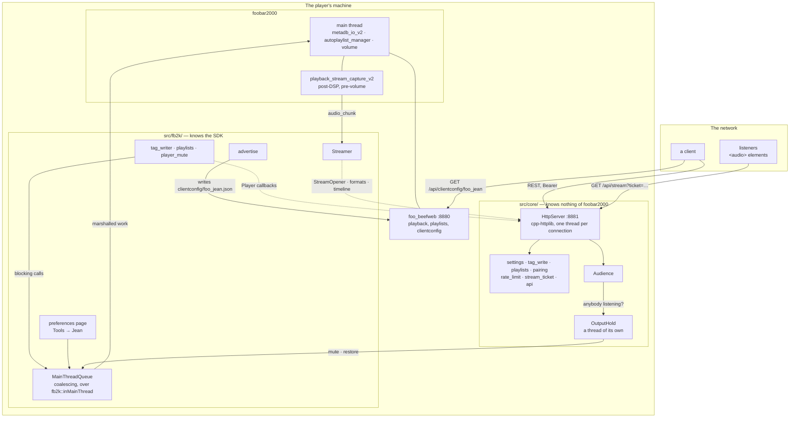
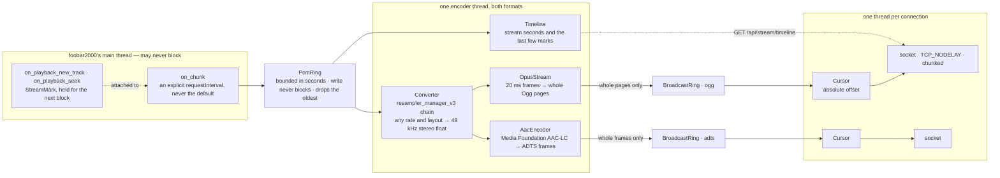

# Architecture

For somebody about to build on this: how the pieces fit, which thread owns what, and why the boundaries sit where they do. [plugins/fb2k/README.md](README.md) is what the component is and how to run it, [plugins/fb2k/CONTRIBUTING.md](CONTRIBUTING.md) is how to write its code, and [src/README.md](src/README.md) is the source tree file by file.

foo_jean is a DLL foobar2000 loads, an HTTP listener on a port of its own, and one live encode of the player's output. It runs alongside beefweb rather than replacing it: beefweb owns playback, playlists, artwork and the filesystem, and a client talks to both.

## The shape of it

Dotted arrows are the inverted ones: `fb2k/` hands `core/` a set of callbacks, and `core/` never names a foobar2000 type.

## The one boundary

`src/core/` compiles with a C++17 compiler and nothing else: no SDK, no Windows, no player. `src/fb2k/` is everything that touches any of the three. Whatever `core/` needs from the player arrives as a callback or a plain value handed in from `fb2k/`, so the dependency points inward and the player is the detail.

**The build enforces it rather than a reviewer.** `src/foo_jean.vcxproj` compiles every `core/*.cpp` with `PrecompiledHeader=NotUsing`, and the precompiled header is the SDK, so a `core/` file that reaches for an SDK type stops compiling. It is a glob, so a new file inherits the rule without anybody remembering. The rule is not taste: cpp-httplib includes `<winsock2.h>`, the SDK includes `<windows.h>`, and the wrong order is a page of Winsock redefinition errors that name none of it.

What the seam buys is the reason to keep it sharp. The security-critical half, meaning the bearer check, CORS, the write allowlist, config parsing, ticket lifetime and the pairing rules, lives in `core/`, so a real `HttpServer` on a real port covers it in a second on any machine. `src/fb2k/` has no coverage at all off the build machine. Put the decision in `core/` and the mechanism in `fb2k/` and that ratio stays good; put a decision in `fb2k/` and it is tested by hand or not at all.

## The seams

Three, all the same shape: `core/` declares what it needs, `fb2k/` supplies it in the component, and `tests/` supplies something else.

| seam | declared in | supplied by | absent means |
|---|---|---|---|
| `Player`, a struct of `std::function`s, one per thing the player can be asked | `core/http_server.h` | `fb2k/component.cpp`, assembled field by field so two callbacks of the same signature cannot swap silently | that route answers `503` |
| `StreamOpener` and `StreamSession` | `core/stream.h` | `fb2k/streamer.cpp` | no streaming, and `canStream` is false |
| `logInfo` and `logError` | `core/log.h` | `fb2k/log.cpp`, or `tests/support/log_capture.cpp` | a link error |

Every `Player` callback blocks until foobar2000 has finished or given up, so each belongs on an HTTP worker and never on the main thread. `fb2k/ask_player.h` is how all of them get there. A null callback is not a fault. It is how an install that switched something off says so, and the route answers `503` rather than pretending.

## The audio path

**Neither end ever stalls the player.** A block the main thread cannot hand off is discarded rather than queued, and a listener the writer laps is dropped rather than waited for. A cursor is an absolute byte offset, so how far behind a listener has fallen is a subtraction that no wraparound can confuse.

**The clock advances from each block's own duration**, not from what was encoded, so it keeps running while nobody is listening. Otherwise every track change during an idle spell would collapse onto one instant. A mark is taken on the main thread, travels attached to the next block of audio rather than being read separately, and is stamped by the encoder with the stream time of the audio it introduces, so the timeline describes what a listener hears rather than what the player is doing.

**A format nobody is listening to is never encoded**, so an idle player burns no core, and the two formats fail apart: one encoder giving up closes its own ring, which ends its listeners' responses so they can reconnect, while the other keeps playing rather than going silent for a fault it did not have.

**Ogg needs its header pages before any audio; ADTS is self-describing**, so a listener joins it at any frame. That is the whole difference between the two preambles. The Ogg stream is never restarted at a track change either, because Firefox stops at the first chained boundary. A decoder can only start reading Ogg from a page boundary, never mid-page, which is why encoded output is gathered into whole pages and handed to the ring in one write per block rather than as each page is produced. A listener's cursor starts wherever the ring currently ends, and that position must be one a fresh decoder can begin at.

**Delivery is 1x and a listener never catches up**, so latency added anywhere is paid for the whole session rather than absorbed. Two defaults charge for it, and both are overridden: libogg gathers a byte count before it emits a page, so pages are built to a duration derived from the bitrate instead (`core/opus_stream.h` has the floor and why it exists), and cpp-httplib leaves Nagle on, so `set_tcp_nodelay` is mandatory once a page is smaller than a segment.

**A connection ends when cpp-httplib drops its content provider, and not reliably before that.** `Audience::Membership`'s destructor is what a socket closing actually triggers, and `StreamSession::next` returning `false` or the writer lambda returning `false` is what makes that happen; nothing else in this component is told a listener is gone.

## Threads, and what may block

The thing least visible from any one file.

| thread | owned by | blocks on | must never |
|---|---|---|---|
| the main thread | foobar2000 | nothing | wait for anything this component does |
| one encoder thread | `Streamer` | `PcmRing::read` | let an exception escape, because it is a thread entry point |
| the hold's watcher | `OutputHold` | `Audience::awaitChangeFrom` | run where the player's volume callback holds a lock |
| the listener | `HttpServer` | `accept` | outlive `stop()` |
| one per connection | cpp-httplib's pool, `max(8, cores - 1)` | `BroadcastRing::read`, or a `Player` callback | outlive `HttpServer::stop()` |

**The main thread reaches this component from five places**: the capture callback, the two playback callbacks that take a mark, the volume callback, the preferences page, and every batch `MainThreadQueue` dispatches. None of them may block. `PcmRing::write` drops its oldest block rather than wait, `MainThreadQueue` coalesces a burst of requests into one main-thread callback rather than one each, and `OutputHold::playerVolumeChanged` takes no lock at all: the mute the hold takes lands on the main thread and comes straight back as a volume callback, which against a held lock is a deadlock.

**Shutdown is `Plugin`'s field order read backwards, with one pair the destructor body governs.** Reverse declaration order would destroy the server before the streamer, and `~HttpServer` joins connection threads that only `Streamer::stop()` can unblock, so the body stops the streamer and then the server. The fields handle the rest: the volume watch dies before the hold it fires at, the hold before the audience it waits on, the audience before the streamer, and `MainThreadQueue` last, so nothing marshals work onto a queue being torn down.

All of that runs from `on_quit`, on the main thread. That is why `askPlayer` runs its work inline when it is already on the main thread: `fb2k::inMainThread` always defers, so queuing from there would wait out the whole timeout for a callback only this thread can dispatch, and the caller that does it is the hold, asking the player to unmute.

**The destructor's first act is `MainThreadQueue::close()`, and it is first for the mirror-image reason.** A request already on a connection thread has marshalled work onto a main thread that is now inside the destructor and will never dispatch it, and `HttpServer::stop()` at the end of the body waits for exactly those requests to finish. So `close()` refuses further work and runs each pending item's `abandon`, settling the answer the caller is blocked on, rather than leaving it to time out. Dropping the work alone would not do: the caller waits on the answer, not on the queue.

## Track identity, and two spellings of a path

Track identity is `%path%` plus `%subsong%`. Playlist items have no id, and any mutation invalidates indices, so every route addresses a track by path.

There are two spellings of that path and they are not interchangeable. `metadb_handle::get_path()` answers the canonical form, which on a portable install is `file-relative://..\Music\x.mp3` where beefweb answers an absolute path for the same file, so a client joining the two on equality would never match. **Everything published to a client goes through `filesystem::g_get_display_path`**, and `POST /api/tags` accepts the display form, so anything answering in the other dialect makes the API disagree with itself.

`metadb::handle_create` will build a handle for any path at all, so being on the write allowlist is not being a track the player manages. The check that the player already knows the track, through the Media Library or an open playlist since plenty of installs have no library configured, is what stands between an allowlisted field and a file foobar2000 has never seen.

## The HTTP contract

**`docs/openapi.yaml` is the contract, and it is hand-written.** There is no framework here to generate one from, and a generated spec would describe the implementation rather than the promise: the descriptions carry the reasoning a client needs, which is the half that matters and the half no generator produces. Clients generate their types from it, so a stale spec is a client that compiles and is wrong. It changes in the same pass as any change to a response shape, a status code or an error string.

Two mechanical checks keep the code and the spec together, and neither can read prose. `tests/api_contract_test.cpp` pins the exact key set of every document the component publishes and drives the stream routes to compare their statuses with the spec's, reading the operation list through `tests/support/spec.h`. `scripts/test.sh` compares the spec's version with `src/core/version.h` before it builds anything.

`core/api.cpp` is the one place a published document is built, which is what stops `/api/status` and the discovery record drifting apart. Every answer of 400 or above carries a JSON `error` string. Bodies are capped at `kMaxBodyBytes`, which the spec documents by that number.

Three routes are reachable without a bearer token: `/api/status`, which says less than a port scan, and `/api/pair` and `/api/stream`, which carry credentials of their own. **A fourth means revisiting the permissive CORS default in the same change**, because that default is safe only while the unauthenticated routes stay that harmless.

## Pairing, and one accepted risk

The token is 64 hex characters, and pairing exists so that nobody has to type it into a phone or a television remote. `POST /api/pair` cannot require a credential, because the caller is asking for one. Four bounds carry it instead: a window somebody opened at the player, with no route that opens one remotely; one grant, the first success closing the window; private source addresses only, parsed rather than prefix-matched and checked *before* the window is consulted, so a caller from outside neither learns whether one is open nor spends the grant; and a history the pane shows and the log keeps, so a pairing nobody performed leaves evidence.

CORS is the fifth. Every other route reflects any origin by default, because every other route needs a token; this one hands one out, so with no `allowedOrigins` configured it admits only an origin whose host matches the `Host` the request was addressed to. `Content-Type: application/json` is required as well, so that a cross-origin caller is always preflighted and a simple `POST` cannot burn a grant blind.

**That same-host rule is defeated by DNS rebinding, and the risk is accepted.** A page served from a hostname resolving to the player's private address satisfies the origin check and the address check both. Requiring an IP literal would close it and would also stop anyone pairing through `http://player.local:8881`, which is how people reach the player. What remains is bounded on every other axis: a two-minute window only a person at the player can open, exactly one grant inside it, a private source, and a pane that names what paired. The attack needs a rebinding page loaded on the local network during a window somebody just opened by hand; the defence against it costs the feature its reason to exist. The trade is deliberate.

Pairing hands out the token the install already has rather than minting one per device, so regenerating the token locks out every device at once. `POST /api/pair` accepts an optional `name`, which is where per-device tokens would attach if they are ever added.

## Absences that shape the design

The code says what is there. These are the gaps to design back into rather than fill.

- **No event stream.** cpp-httplib is thread-per-connection, so a subscription would cost a thread for as long as a client held it. beefweb already raises its `playlists` event for playlists this component creates, so a client subscribed there re-reads `GET /api/playlists` and has the annotation. Streaming is the one thing worth a held thread, which is exactly what `maxConcurrentStreams` bounds.
- **No cache and no index.** For tags and playlists this component is a messenger: accept a request, hand the work to foobar2000, answer. The player already holds the database, and a second copy here would be wrong the moment somebody edited a file outside it.
- **No library scan.** Nothing here walks a directory. Paths arrive from a client and are resolved against what the player reports, and `preview` counts a query through the core's own library index rather than reading anything off disk.
- **No second abstraction behind the boundary.** One architectural seam is enough. `core/` has no plugin registry, no strategy interface with a single implementation, and no layer between a route and the pure function it calls.
- **No per-request bitrate, and no seeking.** One encoder per format feeds every listener of it; a second bitrate would mean a second encoder and a second buffer for as long as anybody held it. Seeking means asking foobar2000 to seek, which moves every listener at once.
- **No route that takes the output hold.** A client may ask for the player to be audible alongside the listeners. When they should be one output again is this component's decision, and it makes it afresh once everybody has stopped listening.
