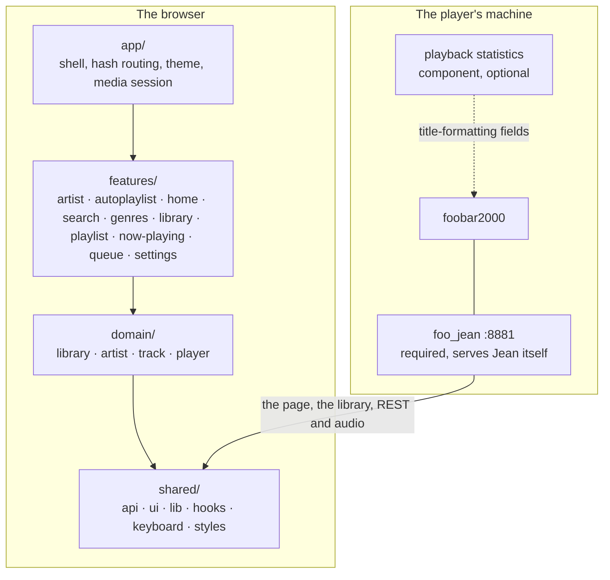

# Architecture

For someone about to build on Jean. Structure, boundaries and contracts: the things a file listing does not show. [CONTRIBUTING.md](./CONTRIBUTING.md) is how to write the code, [src/shared/api/README.md](src/shared/api/README.md) is what the player answers, and [test/README.md](./test/README.md) is the suite and the fake player.

Jean is a Vite single-page app with no backend of its own; [CONTRIBUTING.md](./CONTRIBUTING.md), *Stack*, is what it is built out of. **`foo_jean` serves Jean from its own origin**: the built page, its assets and every route Jean calls share one host and one port, so nothing Jean sends to the player ever crosses an origin.

## The shape of it

Arrows inside the browser are import direction, and they point one way only.

## Tiers

| Tier | Knows about |
|---|---|
| `shared/` | nothing about Jean. The `foo_jean` client and wire types, player-state reading, the playback commands, generic UI, pure helpers, hooks, the keymap, the token layer |
| `domain/` | what Jean is about, as data and behaviour with no route of its own |
| `features/` | one folder per thing a user can do, each owning its own views |
| `app/` | the shell that composes features: `App`, `Sidebar`, `CommandPalette`, theme, hash routing |

**Biome enforces the direction, so a violation fails `pnpm lint`.** `biome.json` carries one `noRestrictedImports` override per tier: `shared/` may not import `@/domain`, `@/features` or `@/app`; `domain/` may not import `@/features` or `@/app`; `features/` may not import `@/app` or another feature, so what two features share lives in `domain/` or `shared/`. Each refusal carries the sentence that says what to do instead.

Biome enforces only the tiers. Inside `domain/` the slices (`library`, `artist`, `track`, `player`) import each other freely, and nothing enforces an order between them.

Import anything outside its own folder through the `@/` alias. Same-folder imports stay relative.

A file whose home is unclear is usually in the wrong tier. Shared infrastructure is not a feature; a domain concept is not one view of it.

## Where state lives

**TanStack Query holds state whose authority lives outside Jean.** `useQuery` reads the cache and writes nothing, except for the rows below that name their own `queryFn`; what writes into every other key is named per row, through `setQueryData`.

| Key | Holds | Written by |
|---|---|---|
| `["player"]` | player state and `activeItem`; in a session, the session's, with volume, mute, output and the playlist fields still the player's | `applyPoll`, from `startPlayerPoll`'s tick and from `pollPlayerNow` |
| `["playlists"]` | the playlist list | `followPlaylists`, off the poll's `playlistsRevision` |
| `["queue"]` | the whole queue, from `foo_jean`; in a session, the session's | `followQueue`, off the poll's `queueRevision` |
| `["session"]` | the document of the session the tab is in | `followSessionDocument`, off the poll's `sessionRevision`; the create and the sharing switch hand it their answer |
| `["sessions"]` | the sessions this device may see | its own `queryFn` in `useSessions`, only while the picker is open |
| `["fooJean"]` | the discovery result | its own `queryFn`: backoff while retryable, focus otherwise |
| `["fooJeanPlaylists", …]` | which playlists the player fills itself | its own `queryFn`, when the playlist count changes |
| `["artistInfo", artist]` | MusicBrainz and Wikipedia | its own `queryFn`; off unless switched on in Settings |
| the library summary, per origin (`useLibrarySummary.ts`, not a query key) | the latest `GET /library/summary` document, kept while the next is asked | `useLibrarySummary.ts`, when the poll announces the library's pair, and on the poll's answered ticks after a failure |

**`["player"]` is written by `applyPoll`, bar two exceptions.** `forgetSession` clears it on a change of session, and the optimistic patches in `playerWrite.ts` edit it ahead of the answer, which the next poll replaces. `startPlayerPoll`'s tick calls it once a second, `pollPlayerNow` calls it again after `usePlayItem` posts a write, and once more `MARK_FOLLOW_UP_MS` after a track change or seek while listening and its `timelineRevision` has not already moved, so nothing lags a whole tick behind. Either way it reads `GET /api/state` and builds the whole snapshot from that document and `capabilities` through `mergePlayer`, but only from an answer to a read asked after the one already drawn. The tick always revalidates against the drawn answer's `ETag`. `watch()` in `domain/player/listenerStore.ts` reads `playbackState` off this same write through `notePlaybackState`, skipping a poll of its own. The queue's writes in `useQueue.ts` patch `["queue"]` the same way, and `settle` rolls a patch back only for a failure that is not a `409`: a stale write means a poll has already replaced the cache, and a failed one says nothing about where the player's queue is, since an answer can go missing after the write landed.

**A change of session is forgotten before anything is drawn under it.** The poll names the session a tab is in and this device, so following one costs no second poll. When the session store's epoch moves, `forgetSession` in `playerPoll.ts` drops the drawn `ETag` and revisions, the queue, the document and the audible history, and leaves `["player"]` with only the fields that answer the player whatever session is named. The poll drops an answer asked under the old epoch, and `audience.ts` drops a roster read asked before the listener's target moved. A tab only controlling a session reads its document at the roster's cadence and after every `200`, through `nobodyListening.ts`, and leaves once nobody has listened for longer than the component's linger.

A poll's playlist is `foo_jean`'s own GUID, and so is every entry `["playlists"]` holds. `useResolvedPlaylistId` in `usePlaylists.ts` checks the poll's GUID against that list and answers one of the three returns of `resolvedPlaylistId`: the GUID where the list carries it, `undefined` while `["playlists"]` has not caught up with the revision the poll last announced, and `null` once it has and the GUID is still absent. Only the front-door resume in `App.tsx` and the cover key `StatusBar` and `NowPlaying` build tell the last two apart. `usePlaylistsCaughtUp` is that distinction: a key with no `queryFn` has no `status` or `isFetching` worth reading, so it compares the revision seen against the one `followPlaylists` last fetched. `["fooJeanPlaylists", …]` is a separate concern, `isAutoPlaylist` rather than the playing set.

`["playlists"]` recovers the way `["queue"]` and the timeline do: off the poll, not a push channel. A missed tick or a dropped connection leaves it stale until the poll's next successful response moves its revision. A failed read leaves it stale only until the next tick retries the same one. `["player"]` carries the whole document and replaces what is stale. The other two reread only when their own revision has moved from the one held, and so does the timeline, which also rereads once whenever a listening connection opens. There is no reconnect protocol behind any of them; the next tick is the whole of the recovery.

**Everything else is a hand-rolled `useSyncExternalStore` store over `src/shared/lib/store.ts`.** That module is the listener half and nothing else: a `Set` of callbacks, `subscribe`, `notify`, `size`. What each store *holds* stays its own business, and there is no shared reducer, no action type and no middleware. `notify()` iterates a copy, since a listener may unsubscribe from inside its own notification and mutating the set mid-iteration would skip its neighbour.

**A stored setting is shared by its key, not copied per caller.** `useStoredState` reads through one map and one listener set, so every hook naming a key sees one value and every write. A `useState` per caller makes a live pair out of every key with two readers. Its snapshot returns the same reference until something writes. `useSyncExternalStore` requires that, and a fresh object each call is an infinite render loop rather than a stale value.

Every Jean setting lives in `localStorage`, on the device that set it. Which session a tab is in lives in `sessionStorage` (`session.ts`), so a reload keeps it and another tab does not share it; so does the mark of which of that session's reports a toast has raised (`sessionDocument.ts`). Belonging to a session and listening to it are the browser's, since every tab sends `foo_jean` the one `deviceId` in `localStorage`.

## The library is held in windows

Jean holds no library. `src/domain/track/libraryWindows.ts` is the controller for one origin: `start()` in `App.tsx` declares Jean's columns once, and from then on a list asks for the rows it draws. `rowWindows.ts` holds them as windows of 2048 rows addressed by position, read through `POST /api/library/rows`, up to 32 of them, and reads 512 rows ahead of a scroll. A window is columnar, one dictionary and one id array per field, so nothing is held per row and `rowAt()` builds a row on the way out for the few dozen a screen draws. A list is a `LibraryList` naming a `structure`, a length and, for a shelf, a set of ordinals; `project.ts` binds it to the windows as the `TrackRows` every list, header and card takes, and a row whose window has not landed draws as a pending row.

A playlist is the same shape: `playlistLoader.ts` reads its windows through `GET /api/playlists/{id}/items` and its album runs through `GET /api/playlists/{id}/runs`, and a playlist of library rows takes the rows from the library's windows. A list of positions, which is what a find in a playlist answers, is the same route asked with `positions` rather than a page, and `rowWindows.ts` holds what it answers as one piece per list beside the pages, read again whole once stale. The library's finder asks `POST /api/library/rows` for its ordinals the way the search dropdown does, through `useSetRows`, and `useFoundRows.ts` is the one hook both finders draw their results from. A `revision` move patches the rows held through `GET /items/changes`; a `structure` move drops the windows, since every position after the first row that moved names another track, and the rows in sight are read again.

**The runs, not the rows, are what a header and a group row need.** `GET /api/library/runs` answers the album runs and the figures over the whole list, so the album groups, the disc rule, the cover of a run and a header's totals come from one small answer rather than from rows nobody has scrolled to.

**A window is read at a `structure` and never drawn at another.** `structure` and `revision` say what a client has to do next rather than what a row holds. The one poll that also carries player state announces the library's pair through `libraryPollFollower` in `libraryFollower.ts`, which `main.tsx` hands to `domain/player/playerPoll.ts` so the player slice never imports the track slice. A moved `revision` marks the windows stale and they are read again where they are in sight; a moved `structure` drops them. `libraryHolds.ts` is what every read of the library shares: the pair asked, the wait after a refusal or a failure, and `watchLibrary`, which the controller, the asker, the summary and the playlists listen on. A failed read is asked again on the next poll tick that answers, once its wait has passed, and never on a timer of its own, so a player that is not answering costs no extra requests. A `refused` or `halted` read is not retried at all.

**The component answers the album, artist and genre pages' questions and the search's.** `libraryAsker.ts` sends each one to `foo_jean` over HTTP and holds the answer, keyed on the library's `structure` as the poll announced it and on the columns that answer it, which a play-count change leaves as they were. An answer counted at another `structure` than the library announced is never drawn, and the question is asked again once the library reaches that one. A view that has waited over 100 ms for an answer (`useWait`) says *Reading your library…* and before that the page looks as it does with nothing to wait for.

**`shared/api/jlib.ts` decodes without copying.** The ids are typed-array views over the bytes as they arrived, which is what the format's four-byte alignment is for, and a dictionary's text stays one `Uint8Array` that a value is sliced out of on demand, because a screen draws a few dozen rows and materialising every value of a large library eagerly costs object overhead nothing reads. `decodeRows` decodes a window and each section is checked against the blob's length before a view is taken over it, since a bad offset is otherwise a throw from a typed-array constructor with nothing in it naming the column.

**Anything caching across the rows keys its answer on the columns it reads, compared by identity.** `slicedOver` in `columnCache.ts` is that cache, one build per set of column objects. A window numbers a value for its own body alone, so no id outlives the windows it was read from.

**`src/domain/track/librarySource.ts` is the one place that knows which source a list reads.** Addressing a row, filling a playlist from it, its artwork and adding rows differ between the media library and a playlist; everything else holds a `LibrarySource` and calls it.

**The component folds the library and the page folds the query.** `foo_jean` folds the text of the library for every match and answers the search, so the page holds none; a playlist's find asks `GET /api/playlists/{id}/find`. The page folds only what is typed, once per query. `fold()` is the same function on both sides of the wire, and the table is generated once for both. The contract's *Folding* paragraph says what it does. `plugins/fb2k/scripts/unicode-tables.mjs` writes the table into `src/shared/lib/asciiFolding.ts` and into `foo_jean`'s own tables from one copy of the CLDR file, and the fold cases in `plugins/fb2k/tests/fixtures/library_questions_cases.json` hold the two folds to the same bytes. A query with no letter or digit in it is matched on its marks with the whitespace taken out of both sides, so a name written in Morse code is found however the typist spaces it, and an unresolved cell carries no search text at all.

## Capability detection

The player evaluates title-formatting expressions and answers them positionally, which makes the reachable surface far wider than any fixed schema. Jean declares a column set once, as name-and-expression pairs, and `fieldTable()` in `src/shared/api/fieldTable.ts` derives both the list sent to the player and the index each name landed at. Written out separately, the day somebody inserts an expression in the middle is the day a row reports its genre as its artist.

The sentinel the player answers with and what `$meta()` cannot do are in [src/shared/api/README.md](src/shared/api/README.md), *Capability detection*. What the architecture adds is where the answer lives: `readValue` maps both an absent and an empty field to `null` so rows draw correctly either way, while `resolvesAnywhere` asks a column whether any of its values resolved.

**The answer is one per install and it comes from the library, not from the rows a view happens to show.** `domain/track/fieldAvailability.ts` holds it, and the only thing that writes to it is `recordWindowAvailability`, fed by the header of every rows answer, which carries `allUnresolved` for each declared column across the whole library. A client declares its columns with a rows request that names no rows, so the first answer settles it before any view needs a window. Landing on a playlist draws the same columns as landing on a shelf. Nothing is ruled out until the player has answered, so no view opens with a column missing, and a column is hidden only where the player cannot produce that field at all.

A fact two components spell differently is a `Pair` in `src/domain/track/fields.ts`, and its `Combination` (`HIGHER`, `LATER` or `EARLIER`) says which answer wins. `pairedReader` applies the pairs, so the play count, the last play and the first play each read as one value. `src/shared/api/README.md`'s table of expressions says which component supplies each. An index means nothing outside its own table, so the pairs are applied by the named readers rather than inside `value()`.

## The two seams

`foo_jean` is required, and the library, the tag writes and the stream all come from it. What is still optional is whether an install permits a write or an encode at all: an empty allowlist switches writing off, and `streamingEnabled` switches listening off. Two interfaces absorb that, and **nothing outside them asks which implementation it is holding.**

| Seam | Interface | Implementations |
|---|---|---|
| `src/domain/track/tagWriter.ts` | `{ canWrite, allowedFields, allows, write, read }` | `NO_WRITER`, `fooJeanWriter` |
| `src/domain/player/listener.ts` | `{ canListen, formats, target }` | `NO_LISTENER`, the one `resolveListener` builds |

Both answer rather than throw. `NO_WRITER.write` resolves to a refusal carrying a message, so a caller renders the same failure path whether writing is switched off at the player, the component is unreachable, or the write was declined.

**Every switch behind either seam is the player owner's**, held in `config.json` and reloaded live from the Permissions page; Jean neither grants nor stores one. **Playing a set is playback, not a playlist edit.** On the player, filling the scratch playlist to play an arbitrary row follows `controlPlayback`, never `writePlaylists`, however much it looks like a playlist write from here. In a session nothing is filled, and `foo_jean`'s `controlPlayback` governs the player's own session alone, so `useCanControlPlayback()` answers true there whatever the switch says.

**`write` is handed an address, never a filesystem path.** A track is named by one of three forms. Where the media library holds it, by its library-relative path with the subsong inside the file it names, or by its ordinal in the snapshot with the generation that ordinal was read at. Where the library does not hold it, by a playlist GUID, a position and the structure generation those rows were read at. A source answers the forms for its own rows out of tables it already holds, so nothing between a star and the write resolves anything, and the component matches each of them against what the player itself produced. A row the media library holds takes a library form even where it was read from a playlist: a relative path survives a reorder and a rebuild, a position survives neither, and what stops a stale position writing to somebody else's file is the component comparing that generation and answering `409`. No filesystem path crosses the wire at all, which is what makes a library on a UNC share rateable.

**A client refused an ambiguous address retries exactly once with a precise one, and nothing else in the rating path is ever sent twice.** Two media library roots can hold one library-relative path, which puts a track under each at one address, and the component refuses such an address rather than writing to whichever sorts first. So a source answers the relative path first and the address that names exactly one track behind it: the media library its ordinal and the snapshot's structure, a playlist row its GUID, position and generation, the now-playing screen where the player says it is playing from. A surface holding nothing behind the path says the rating did not land. The retry is safe because an ambiguity refusal is decided before anything is written.

Both are fed by one discovery, in `src/shared/api/discovery.ts`, deduped through `src/shared/hooks/useFooJean.ts`. Every caller names one query key, so the second component to mount reads the first one's result rather than probing again.

## Requests

Every request to `foo_jean` goes through `ask` in `src/shared/api/client.ts`: one `openapi-fetch` client typed from `fooJeanSchema.d.ts`, a deadline, and the caller's own signal. **A call never answers `null` for a failure and throws only when its caller aborted it; it resolves to a `Result`**, `{ ok: true, value }` or a `Failure` that is either `unreachable` or `refused` with the status, the body's `error`, a message and, on a `429`, how long to wait. `settle` builds it and `askResult` is the two together. A resource module whose callers act on particular refusals names them in a union of its own on the same `ok` discriminant, as `tags.ts`, `state.ts`, `queue.ts` and the stream ticket do. A caller that has to throw, which is any React Query function, throws a `FooJeanFailed`, through `orThrow` wherever every failure is a throw, and reads the failure back off it: `retryWhenTooFast`, `refusedStatusOf` and `switchRefusalThrown` are those readers. What a browser loads by itself, artwork and the stream, is built as a URL and never requested here. `artwork.ts` builds three cover addresses, and a row takes the first it can. A row the library holds reads `libraryArtworkUrl()` through the track the runs answer names in `covers`, so every row of an album shares one address. A row with no library path but a playlist position reads `playlistRowArtworkUrl()`. One with neither draws no cover. The playing track resolves the same way off `activeItem` and falls back to `playingArtworkUrl()` where the library holds no album for it.

While a tab is in a session, `ask` hands each call a copy of the client scoped to it (`setSessionScope`), which names the session and this device on every path `SESSION_SCOPED` lists. A call's own `session` or `deviceId` wins over the scope.

## The `foo_jean` security model

`discoverFooJean()` in `discovery.ts` takes the component's origin straight off `window.location.origin` and asks `GET /api/capabilities` with no credential to attach; nothing Jean sends needs one. What decides whether the request lands at all is the component's own admission rule, a private source address behind a `Host` it recognises, run ahead of anything Jean does; `plugins/fb2k/ARCHITECTURE.md` has the rule itself.

**Discovery resolves to a state, and neither one is silence.** `FooJeanState` is `unreachable` or `ready`, the union declared beside `discoverFooJean()`. `src/features/settings/TagWriting.tsx` holds a message and a remedy for each, plus for a ready component with no writable field and one with no stream.

**Which project owns which setting.** The component's `config.json` holds what the *player owner* decides: port, bind address, and every switch named beside *The two seams* above. Jean never edits it and there is no route to it. Jean owns, per field, whether to offer the control at all. **Those switches narrow and never widen.** Settings lists exactly the permitted fields and turns them off, never on.

## The phrase catalogue

Every string a person reads is a key in `src/shared/i18n/en.ts`, resolved by `t()` against whatever language is showing. The catalogue sits in `shared/` for the same reason `tokens.css` does: every tier draws from it, and the import direction only runs one way. [CONTRIBUTING.md](./CONTRIBUTING.md), *Phrases*, is how to write one.

## The `z-index` scale

App-level layers, lowest first. These share the root stacking context, so a new layer is placed against this list rather than picked.

| Layer | `z-index` |
|---|---|
| List toolbar (`TrackBrowser`) | 10 |
| Toolbar pill slot | 12 |
| Find-within results (`Finder`) | 20 |
| Anchored menu (`Menu`) | 25 |
| Now-playing screen | 25 |
| Queue panel scrim, compact | 29 |
| Queue panel · volume popover in the compact status bar · status bar, desktop | 30 |
| Sidebar scrim, compact | 39 |
| Sidebar drawer, compact | 40 |
| Search dropdown | 42 |
| Track info screen · lyrics screen · lyric editor | 45 |
| Playback picker sheet, compact | 47 |
| Alert dialog (`AlertDialog`) | 49 |
| Toasts · modal dialog backdrop (`ModalDialog`) · shortcut sheet backdrop | 50 |
| Command palette backdrop | 60 |
| Action menu and its scrim | 70 |
| Drag ghost | 80 |

Lyrics and the lyric editor sit above the app chrome, the queue panel and the now-playing screen, and **under** toasts and menus, so a failed write can still say so. The playback picker's sheet sits under the toasts too, so a refusal raised while it is open is seen. The drag ghost is above everything, since a drag can start anywhere. The seek bar reaches above the status bar's top edge, so on desktop the status bar is lifted to the queue panel's layer and wins the tie by coming later in the document. The listen-here popover and the output menu open inside it, in its stacking context, and so still clear the queue panel. The playback order list is an `ActionMenu`, portalled to `body` on the action menu's layer.

## Layout and viewport

The shell is a fixed-height flex column rather than a scrolling document. That pins the status bar by construction instead of `position: sticky`, gives the virtualiser the explicit scroll element it needs, and leaves somewhere for safe-area insets to live.

**A list taller than `MAX_SCROLL_HEIGHT` scrolls through a scale.** `shared/ui/scaledScroll.ts` caps the scroller's height there and maps the virtualiser's content offsets onto `scrollTop`, with a scale of exactly 1 at or under the cap. Scroll memory reaches the mapping through `registerScaledScroller`. Over the cap a jump to the playing track sets `scrollTop` and settles on the row without animating, for the browser limit *Facts about the browser* gives.

Below the compact breakpoint the sidebar becomes a drawer, menus become sheets, and several components are a *different component* rather than a narrower one, which is why every spec runs on both a desktop and a mobile project.

## Listening on this device

The stream runs behind the player, so a listening device draws what it hears, not what the poll says. **`audible.ts` is the one branch**: nothing listening, it returns the live snapshot by identity; listening, only `activeItem` runs late, and every surface that draws time reads the audible position from `position.ts`.

`listener.ts` turns `foo_jean`'s stream clock into that position, `listenerStore.ts` fixes the anchor once per connection, from that connection's first timeline reading, and the poll corrects it. A track change or a seek lays a mark: `rememberSnapshot` notices either, `pollPlayerNow` follows it `MARK_FOLLOW_UP_MS` later, and `beginSeek` holds the display at the target until the audio arrives.

## Facts about the browser

What a browser does that several files here depend on.

- A grid or flex item is never sized below its min-content, and an `<input>` asserts a default width on every ancestor that `min-width: 0` on the input does not withdraw; `width: 0` does. One control that refuses to shrink widens the document, which on a phone scrolls sideways.
- Pressing a control without `user-select: none` starts a text selection, and dragging a selection is a native drag of a snapshot of the control.
- A `<button>` centres its text where an `<a>` does not. CSS `width` and `height` on an `svg` beat the attributes lucide writes.
- Some touch browsers fire `dblclick` for a fast double tap.
- A programmatic scroll fires the same `scroll` event as a finger, and `scrollend` is not in every browser.
- An element is as tall as the browser allows and no taller. Firefox honours a height up to 17,895,697 px and ignores a taller one rather than clamping it (Bugzilla 1205604). Chrome clamps at 33,554,400 px and Safari at 33,554,428 px.

## Absences that shape the code

- **No folder tree.** The library browses as one flat list.
- **No Web Worker and no IndexedDB.** Nothing of the library is kept on the device.
- **Nothing Jean fetches survives a reload**, artwork included. Covers persist in the browser's own HTTP cache, which is the component's to control through `Cache-Control` and `ETag`.
