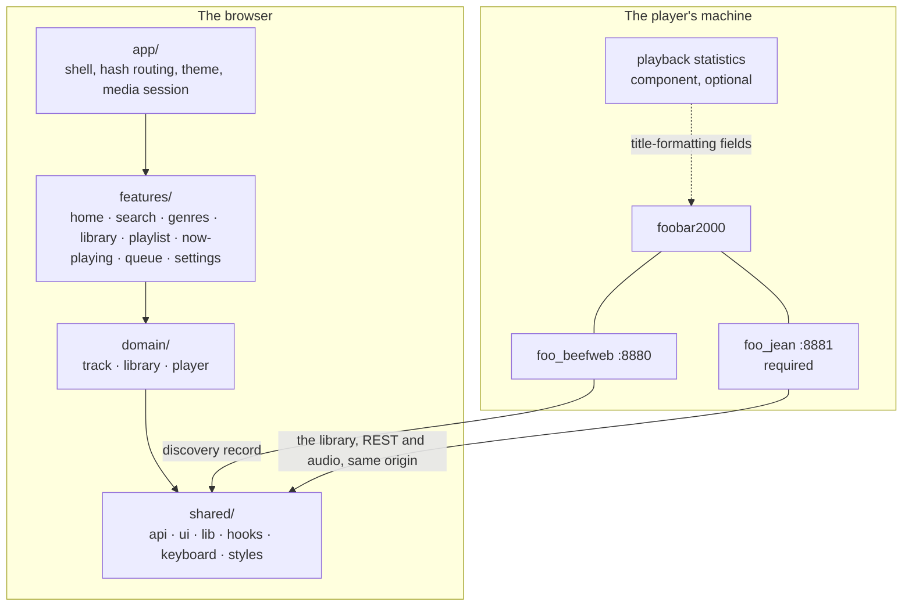
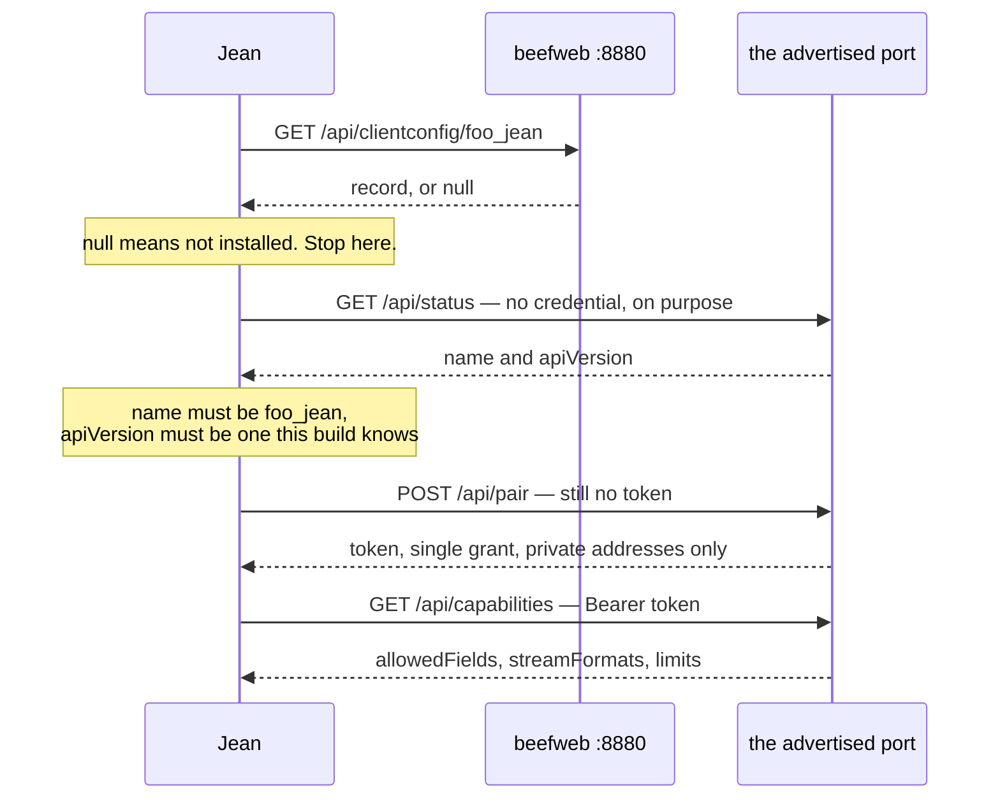

# Architecture

For someone about to build on Jean. Structure, boundaries and contracts: the things a file listing does not tell you. [CONTRIBUTING.md](./CONTRIBUTING.md) is how to write the code; [src/shared/api/README.md](src/shared/api/README.md) is what the player answers.

Jean is a Vite single-page app with no backend of its own; [CONTRIBUTING.md](./CONTRIBUTING.md), *Stack*, is what it is built out of. **Jean is served same-origin with beefweb**, which is what the two things Jean still asks it for rest on: it serves the bundle itself, and it hosts `foo_jean`'s discovery record at `GET /api/clientconfig/foo_jean`, root-relative and resolved against whatever origin served the page, so discovery needs no CORS and no port scanning. `foo_jean` listens on a port of its own, so playback, the library, its covers and every tag write are cross-origin and carry a bearer token through a preflight the component answers with a 600 second `Access-Control-Max-Age`.

## The shape of it



Arrows inside the browser are import direction, and they point one way only.

## Tiers

| Tier | Knows about |
|---|---|
| `shared/` | nothing about Jean. The `foo_jean` client and wire types, player-state reading, the playback commands, generic UI, pure helpers, hooks, the keymap, the token layer |
| `domain/` | what Jean is about, as data and behaviour with no route of its own |
| `features/` | one folder per thing a user can do, each owning its own views |
| `app/` | the shell that composes features: `App`, `Sidebar`, `CommandPalette`, theme, hash routing |

**Biome enforces the direction, so a violation fails `pnpm lint`.** `biome.json` carries one `noRestrictedImports` override per tier: `shared/` may not import `@/domain`, `@/features` or `@/app`; `domain/` may not import `@/features` or `@/app`; `features/` may not import `@/app`. Each refusal carries the sentence that says what to do instead.

Within `domain` the slices form a DAG: `library → track → player`. Sideways is allowed; a cycle is not.

Import anything outside its own folder through the `@/` alias. Same-folder imports stay relative.

A file whose home is unclear is usually in the wrong tier. Shared infrastructure is not a feature; a domain concept is not one view of it.

## Where state lives

Two mechanisms, and the split is not arbitrary.

**TanStack Query holds state whose authority lives outside Jean.** `useQuery` is a pure cache reader everywhere; what writes into a key is named per row below, through `setQueryData`.

| Key | Holds | Written by |
|---|---|---|
| `["player"]` | player state and `activeItem` | `applyPoll`, from `startPlayerPoll`'s tick and from `pollPlayerNow` |
| `["playlists"]` | the playlist list | `recheckPlaylists`, off the poll's `playlistsRevision` |
| `["queue"]` | the whole queue, from `foo_jean` | `recheckQueue`, off the poll's `queueRevision` |
| `["fooJean", token]` | the discovery result | backoff while retryable, focus otherwise |
| `["fooJeanPlaylists", …]` | which playlists the player fills itself | when the playlist count changes |
| `["artistInfo", artist]` | MusicBrainz and Wikipedia | never; off unless switched on in Settings |

**`["player"]` has one writer: `applyPoll`.** `startPlayerPoll`'s tick calls it once a second; `pollPlayerNow` calls it once more, right after `usePlayItem` posts a write, so `activeItem` need not wait out a whole tick to catch up. Either way it reads `GET /api/state` and builds the whole snapshot from that document and `capabilities`, through `mergePlayer` in `playerPoll.ts`. `permissions.changeClientConfig` is the one field neither the document nor `capabilities` speaks for, so it carries forward from the previous tick with nothing to correct it. Everything else is overwritten on every tick, whoever wrote it last: `watch()` in `domain/player/listenerStore.ts` reads `playbackState` off this same write through `notePlaybackState`, which is what lets it skip a direct call to beefweb.

**A poll's playlist is already `foo_jean`'s own GUID, and so is every entry `["playlists"]` holds.** `useResolvedPlaylistId` confirms the GUID the poll answers still names a playlist the list carries, rather than resolving one address into another. **It answers `undefined` rather than `null` while `["playlists"]` has not caught up with the revision the poll last announced, and `null` once it has and the guid still is not there**, so a reader can tell a confirmation with no answer yet from one that has answered absent; everywhere but the app's front-door resume and the cover key `StatusBar` and `NowPlaying` build from it, the two collapse to the same absence. `usePlaylistsCaughtUp` carries that distinction by comparing the revision a caller has seen against the one `recheckPlaylists` last fetched, since `["playlists"]` takes no `queryFn` of its own for `status` or `isFetching` to mean anything. `["fooJeanPlaylists", …]` is a separate concern, `isAutoPlaylist` rather than the playing set, and refetches on its own schedule when `useAutoPlaylists.ts`'s effect sees the playlist count move.

`["playlists"]` recovers the same way `["queue"]` does, off the poll rather than a push channel: a missed tick or a dropped connection leaves it stale until the poll's next successful response reports a moved `playlistsRevision`. `["player"]` carries the whole document and replaces what is stale; `["queue"]` and `["playlists"]` each refetch only when their own revision has moved from the one already cached. There is no reconnect protocol behind any of the three, and nothing replays; the next tick is the whole of the recovery.

**Everything else is a hand-rolled `useSyncExternalStore` store over `src/shared/lib/store.ts`.** That module is the listener half and nothing else: a `Set` of callbacks, `subscribe`, `notify`, `size`. What each store *holds* stays its own business, and there is no shared reducer, no action type and no middleware. `notify()` iterates a copy, since a listener may unsubscribe from inside its own notification and mutating the set mid-iteration would skip its neighbour.

Nine modules build on it: `playlistStore`, `ratingStore`, `listenerStore`, `audience`, `queueClock`, `toastStore`, `dnd`, `keyboardOwner` and `useStoredState`.

**A stored setting is shared by its key, not copied per caller.** `useStoredState` reads through one map and one listener set, so every hook naming a key sees one value and every write. A `useState` per caller makes a live pair out of every key with two readers. Its snapshot returns the same reference until something writes. `useSyncExternalStore` requires that, and a fresh object each call is an infinite render loop rather than a stale value.

Jean's settings live in `localStorage` today and belong in beefweb's `/api/clientconfig/{id}` so they follow the user between devices; the hook's signature is the shape a server-backed version would have, falling back to local storage where `permissions.changeClientConfig` is false. Four keys are permanently excluded from that move, and the exclusion is named next to `TOKEN_KEY` in `src/shared/api/fooJean.ts`: the `foo_jean` token, since beefweb serves the `clientconfig` namespace unauthenticated and syncing a credential would recreate the escalation it exists to prevent, plus the three keys that describe *one device*: its listening volume, its id and its name.

## The library is one array

`src/domain/track/playlistStore.ts` loads the library and publishes a `PlaylistSnapshot`: `columns`, one dictionary and one id array per field, plus `paths` and `subsongs` parallel to them on either source and derived `heat` and `patina` as `Float32Array`. A view is a set of **refs**, `Int32Array | number[]`, where a ref is a playlist index on one source and an ordinal in the snapshot on the other. `project()` binds a set of refs to those columns as a `TrackRows`, which is what every list, header and index takes; `refAt()` is the one place that knows a null ref list means "everything, in order".

It is a flat array rather than a tree for three reasons. beefweb answers ranges, not nodes. A ref into a flat array is an integer, so a filtered view is a typed array and a selection is a set of integers. And every screen in Jean is a filter over the same list, whether a shelf, a genre or a search, so a tree would be rebuilt per view and thrown away.

Chunking is a playlist read's problem: it is almost all round trip, so the first chunk is small enough to paint from and the rest are large and concurrent. The library does not arrive that way. `foo_jean` answers it as one columnar snapshot, dictionary-encoded per column, with a per-column delta behind it, so the schedule is one request and then patches rather than a queue of reads.

A playlist held already gets the same treatment once loaded: a `revision` move alone patches through `GET /items/changes` rather than re-chunking, and only a `structure` move sends `playlistStore.ts` back to the chunked read, under a fresh cache key.

**The export request is Jean's column declaration, so the first ask may be a `202`.** `shared/api/fooJeanLibrary.ts` names the whole set on every request, and a `202` means the component holds no snapshot of that set and has started one, so the loader polls `GET /api/state` with a backoff until its `library` section reports `ready` with a matching `columns` set, and asks again, giving up at a build deadline. Every failure comes back as a named reason rather than a throw, so a view draws a state for an unreachable component, an unauthorised one, a refusal, a library over the component's ceiling and a build that never finished, and a `429` waits out the component's own `Retry-After`.

**`shared/api/jlib.ts` decodes without copying.** The ids are typed-array views over the bytes as they arrived, which is what the format's four-byte alignment is for, and a dictionary's text stays one `Uint8Array` that a value is sliced out of on demand, because a screen draws a few dozen rows and materialising every value of a large library eagerly costs object overhead nothing reads. Each section is checked against the blob's length before a view is taken over it, since a bad offset is otherwise a throw from a typed-array constructor with nothing in it naming the column.

**The two generations live on the store entry, beside the poller, and never on the data.** `structure` and `revision` say what a client has to do next rather than what a row holds, and the thing that acts on them is the store. `recheckComponentLibrary` takes the generations off the `library` section of whatever `GET /api/state` last answered, patches where the ordinals still hold and exports again where they do not; `domain/player/playerPoll.ts` is what calls it, on every tick of the one poll that also carries player state, because almost every revision comes from a track finishing and that poll already learns about those.

**A patch replaces the columns it names and leaves the rest alone, identity and all.** That is the whole point of a per-column delta: every derived structure in Jean is built from named columns, so a play count moving must invalidate the heat and patina arrays and touch neither the folded search text nor the artist and genre groupings. Anything caching across the rows declares which fields it reads and compares them by identity; `someFieldMoved` is that comparison and `growingIndex` and `foldCache` are the two that use it. An index whose fields a delta did move is rebuilt rather than extended, since a draft already summed cannot be un-summed.

**A cache across the rows is keyed on the generation, not on the origin.** `generationKey` is that key, and it is separate from the store's own, which stays put so a rebuild replaces one entry's rows rather than making a second entry. Dictionary ids are append-only within a generation and renumbered across one, so a fold cache keyed on the origin alone would answer the new snapshot from the old snapshot's ids.

**Both sources are columnar, and nothing holds a row.** The playlist loader interns the rows `foo_jean` answers into the same dictionaries and id arrays the component's library snapshot arrives as, so the expensive consumers -- grouping, the entity indices, the search haystack, the heat and patina arrays -- are written once and run over integers. `rowAt()` builds a row on the way out for the few dozen a screen draws, and `TrackRows.at()` is the only thing that calls it.

**Anything derived per row is keyed on `columns.load`.** That object lives exactly as long as one load's data and survives both the next chunk arriving and a delta being patched in, so an overlay keyed on it dies with the rows it patches and needs no invalidation.

**Search folds once per distinct value, never per keystroke and never per row.** `libraryIndex()` keeps the folded text of each dictionary entry, keyed by whatever makes an id mean one thing: the structure generation on either source. A search is then one `includes()` per searchable column, against text `fold()` has already been through.

**`useLibrary` returns an object literal, so its identity changes every render.** Depend on `library.snapshot`, the store's own object, replaced only when a load publishes.

## Capability detection

The player evaluates title-formatting expressions and answers them positionally, which makes the reachable surface far wider than beefweb's own schema. Jean declares a column set once, as name-and-expression pairs, and `fieldTable()` in `src/shared/api/fieldTable.ts` derives both the list sent to the player and the index each name landed at. Written out separately, the day somebody inserts an expression in the middle is the day a row reports its genre as its artist.

The sentinel the player answers with and what `$meta()` cannot do are in [src/shared/api/README.md](src/shared/api/README.md), *Capability detection*. What the architecture adds is where the answer lives: `readValue` maps both an absent and an empty field to `null` so rows draw correctly either way, while `resolvesAnywhere` asks a column whether any of its values resolved.

**The answer is one per install and it comes from the library, so every route loads the library.** `domain/track/fieldAvailability.ts` holds it and the library snapshot is the only thing that writes to it, so no view can compute a different one from the rows it happens to be showing. Landing on a playlist draws the same columns as landing on a shelf. Nothing is ruled out until the library has answered, so no view opens with a column missing, and a column is hidden only where the player cannot produce that field at all.

A fact the player may spell two ways gets an *alternative* rather than a branch, and `alternativeReader` falls through from one spelling to the other. The play count is the one that has two, and `src/shared/api/README.md`'s table of expressions is which component supplies each. An index means nothing outside its own table, so the map is applied by the named readers rather than inside `value()`.

## The two seams

`foo_jean` is required, and the library, the tag writes and the stream all come from it. What is still optional is whether an install permits a write or an encode at all: an empty allowlist switches writing off, and `streamingEnabled` switches listening off. Two interfaces absorb that, and **nothing outside them may ask which implementation it is holding.**

| Seam | Interface | Implementations |
|---|---|---|
| `src/domain/track/tagWriter.ts` | `{ kind, canWrite, allowedFields, allows, write }` | `NO_WRITER`, `agentWriter` |
| `src/domain/player/listener.ts` | `{ kind, canListen, formats, target }` | `NO_LISTENER`, the agent listener |

Both answer rather than throw. `NO_WRITER.write` resolves to a refusal carrying a message, so a caller renders the same failure path whether writing is switched off at the player, the device is unpaired, or the write was declined. If anything outside these files has to branch on `kind`, the seam is in the wrong place.

**`write` is handed an address, never a filesystem path.** A track is named by one of three forms. Where the media library holds it, by its library-relative path with the subsong inside the file it names, or by its ordinal in the snapshot with the generation that ordinal was read at. Where the library does not hold it, by a playlist GUID, a position and the structure generation those rows were read at. A source answers the forms for its own rows out of tables it already holds, so nothing between a star and the write resolves anything, and the component matches each of them against what the player itself produced. A row the media library holds takes a library form even where it was read from a playlist: a relative path survives a reorder and a rebuild, a position survives neither, and what stops a stale position writing to somebody else's file is the component comparing that generation and answering `409`. No filesystem path crosses the wire at all, which is what makes a library on a UNC share rateable.

**A client refused an ambiguous address retries exactly once with a precise one, and nothing else in the rating path is ever sent twice.** Two media library roots can hold one library-relative path, which puts a track under each at one address, and the component refuses such an address rather than writing to whichever sorts first. So a source answers the relative path first and the address that names exactly one track behind it: the media library its ordinal and the snapshot's structure, a playlist row its GUID, position and generation, the now-playing screen where the player says it is playing from. A surface holding nothing behind the path says the rating did not land rather than failing quietly. The retry is safe where repeating a `504` is not, because an ambiguity refusal is decided before anything is written, and a timeout leaves it open whether the write landed.

Both are fed by one discovery, in `src/shared/api/fooJean.ts`, deduped through `src/shared/hooks/useFooJean.ts`. Every caller names one query key, so the second component to mount reads the first one's result rather than probing again.

## The `foo_jean` security model

The component publishes a discovery record at beefweb's `clientconfig` namespace. **That record is writable by anyone who can reach beefweb**: `POST /api/clientconfig/{id}` is a real route, `changeClientConfig` defaults to true, and beefweb ships with no authentication of its own. A forged record can name any port, and the forgery lasts until the component next starts. **So the advertisement is a hint, never a credential target.**



Read the record, prove the port with an unauthenticated call, and only then attach the token. Skipping the middle step hands a credential to whoever forged the record. That leaves the attack needing someone who can already run a listener on the player's machine.

**Pairing is a write, so it obeys the same order.** `discovery.origin` is non-null exactly when the probe succeeded, which makes it the proof a port is safe to post to, so the Pair button renders on `origin` rather than on the state kind, and an unreachable or impostor port never gets one.

**Discovery resolves to a state, and none of the states is silence.** They are the union declared beside `discoverFooJean()`, and the component is installed and working in five of them. `src/features/settings/TagWriting.tsx` holds one message and one remedy per state, *impostor* included, where Jean must say it did not send the token.

**Which project owns which setting.** The component's `config.json` holds what the *player owner* decides: port, bind address, the write allowlist. Jean never edits it and there is no route to it. Jean owns the token and, per field, whether to offer the control at all. **Those switches narrow and never widen.** Settings lists exactly the permitted fields and turns them off, never on.

## Sequencing

Jean has more sequential work than a player client suggests. Only the first chunk of a library fill may `replace`, and `Promise.all` arrives in whatever order the network settles on.

> **The trap is `void`.** `done.then(() => void run(...))` calls each step in turn and hands `undefined` to `then`, so nothing waits for anything and the sequencing is silently gone. Return the promise.

## The phrase catalogue

Every string a person reads is a key in `src/shared/i18n/en.ts`, resolved by `t()` against whatever language is showing. The catalogue sits in `shared/` for the same reason `tokens.css` does: every tier draws from it, and the import direction only runs one way.

```
src/shared/i18n/
  en.ts            every phrase, flat and sorted. Imports nothing
  message.ts       what a message is, and the types that read its fields off the literal
  locale.ts        the store: which language, what is loaded, and the module-level translate()
  format.ts        memoised Intl constructors, keyed by locale
  useTranslate.ts  the hooks a component uses
  Trans.tsx        a sentence with elements inside it
```

Which languages exist, how one reaches the app, how a phrase is written and what `t()` demands of a key chosen at runtime are all in [src/shared/i18n/CLAUDE.md](src/shared/i18n/CLAUDE.md), which is the whole of it.

## The `z-index` scale

How to write a stylesheet at all is [CONTRIBUTING.md](./CONTRIBUTING.md), *Styling*. This is the one part of it that is shared rather than local, and therefore the one part that belongs here.

App-level layers, lowest first. These share the root stacking context, so a new layer has to be placed against this list rather than picked.

| Layer | `z-index` |
|---|---|
| List toolbar (`TrackBrowser`) | 10 |
| Toolbar pill slot | 12 |
| Find-within results (`Finder`) | 20 |
| Anchored menu (`Menu`) | 25 |
| Now-playing screen | 25 |
| Queue panel scrim, compact | 29 |
| Queue panel · volume popover · listen-here popover · status bar, desktop | 30 |
| Sidebar scrim, compact | 39 |
| Sidebar drawer, compact | 40 |
| Search dropdown | 42 |
| Track info screen · lyrics screen | 45 |
| Toasts · settings backdrop · shortcut sheet backdrop | 50 |
| Command palette backdrop | 60 |
| Action menu and its scrim | 70 |
| Drag ghost | 80 |

The gaps are deliberate. Lyrics sit above the app chrome, the queue panel and the now-playing screen, and deliberately **under** toasts and menus, because a write that failed still has to be able to say so. The drag ghost is above everything, since a drag can start anywhere. The seek bar reaches above the status bar's top edge, so on desktop the status bar is lifted to the queue panel's layer and wins the tie by coming later in the document; its popovers stack inside it and so still clear the queue panel.

Values of `0`–`5` appear inside `AlbumCard`, `ShelfRow`, `GenreTile`, `TrackPanels`, `QueuePanel` rows, `ActionMenu` pages and the `Sidebar` row being dragged. Those are local to a stacking context their own component establishes and mean nothing outside it. Do not read them against this table.

## Layout and viewport

The shell is a fixed-height flex column rather than a scrolling document. That pins the status bar by construction instead of `position: sticky`, gives the virtualiser the explicit scroll element it needs, and leaves somewhere for safe-area insets to live.

Below the compact breakpoint the sidebar becomes a drawer, menus become sheets, and several components are a *different component* rather than a narrower one. That is why the test suite runs every spec on both a desktop and a mobile project.

**An absolutely positioned grid item takes its containing block from an explicit `grid-column`, not from the grid as a whole.** That is how the now-playing screen tracks `.body`'s own column transition on a desktop, with no inset computed from `--sidebar-width`.

**A CSS size container query measures the content box, not the border box.** A threshold meant to read as the padded width has to subtract the padding, or it fires one padding-width late.

## The fake player

`test/fake-api/` is an in-memory foobar2000: portable route tables with no host in them, plus the node sockets that serve them. `demo/sw.ts` hands the same tables a service worker `fetch` event, which is how the live demo runs a whole player in the browser. The seam is `Responder` in `test/fake-api/http.ts`.

Two consequences before adding a route: anything reaching for a socket, a file or a `Buffer` belongs in the host files rather than the route tables, and fixtures are imported rather than read off disk, since one of the two hosts has no filesystem. [test/README.md](./test/README.md) is the rest of it.

## Absences that shape the code

The code says what exists. These are load-bearing gaps anything built on Jean has to account for.

- **No Web Worker and no IndexedDB persistence**, so a cold start re-fetches and re-indexes. Both are requirements for a very large library, not things already done.
- **No folder tree.** The library browses as one flat list. `/library/items/by-path` is documented in `src/shared/api/README.md` for when that changes.
- **Nothing Jean holds survives a reload**, artwork included. Covers persist in the browser's own HTTP cache, which is the component's to control through `Cache-Control` and `ETag`; Jean stores none of it.
