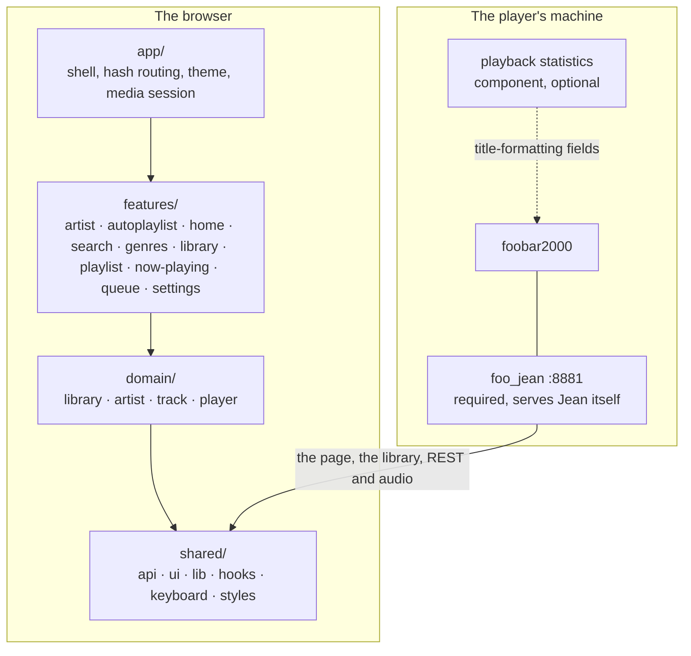

# Architecture

For someone about to build on Jean. Structure, boundaries and contracts: the things a file listing does not tell you. [CONTRIBUTING.md](./CONTRIBUTING.md) is how to write the code, [src/shared/api/README.md](src/shared/api/README.md) is what the player answers, and [test/README.md](./test/README.md) is the suite and the fake player.

Jean is a Vite single-page app with no backend of its own; [CONTRIBUTING.md](./CONTRIBUTING.md), *Stack*, is what it is built out of. **`foo_jean` serves Jean from its own origin**: the built page, its assets and every route Jean calls share one host and one port, so nothing Jean sends to the player ever crosses an origin.

## The shape of it

Arrows inside the browser are import direction, and they point one way only.

## Tiers

| Tier | Knows about |
|---|---|
| `shared/` | nothing about Jean. The `foo_jean` client and wire types, player-state reading, the playback commands, generic UI, pure helpers, hooks, the keymap, the token layer |
| `domain/` | what Jean is about, as data and behaviour with no route of its own |
| `features/` | one folder per thing a user can do, each owning its own views |
| `app/` | the shell that composes features: `App`, `Sidebar`, `CommandPalette`, theme, hash routing |

**Biome enforces the direction, so a violation fails `pnpm lint`.** `biome.json` carries one `noRestrictedImports` override per tier: `shared/` may not import `@/domain`, `@/features` or `@/app`; `domain/` may not import `@/features` or `@/app`; `features/` may not import `@/app` or another feature, so what two features share lives in `domain/` or `shared/`. Each refusal carries the sentence that says what to do instead.

Within `domain` the slices form a DAG: `library → artist → track → player`. Sideways is allowed; a cycle is not.

Import anything outside its own folder through the `@/` alias. Same-folder imports stay relative.

A file whose home is unclear is usually in the wrong tier. Shared infrastructure is not a feature; a domain concept is not one view of it.

## Where state lives

**TanStack Query holds state whose authority lives outside Jean.** `useQuery` reads the cache and writes nothing, except for the rows below that name their own `queryFn`; what writes into every other key is named per row, through `setQueryData`.

| Key | Holds | Written by |
|---|---|---|
| `["player"]` | player state and `activeItem`; in a session, the session's, with volume, mute, output and the playlist fields still the player's | `applyPoll`, from `startPlayerPoll`'s tick and from `pollPlayerNow` |
| `["playlists"]` | the playlist list | `followPlaylists`, off the poll's `playlistsRevision` |
| `["queue"]` | the whole queue, from `foo_jean`; in a session, the session's | `followQueue`, off the poll's `queueRevision` |
| `["session"]` | the document of the session the tab is in | `followSessionDocument`, off the poll's `sessionRevision`; the create and the sharing switch hand it their answer |
| `["sessions"]` | the sessions this device may see | its own `queryFn` in `useSessions`, only while the picker is open |
| `["fooJean"]` | the discovery result | its own `queryFn`: backoff while retryable, focus otherwise |
| `["fooJeanPlaylists", …]` | which playlists the player fills itself | its own `queryFn`, when the playlist count changes |
| `["artistInfo", artist]` | MusicBrainz and Wikipedia | its own `queryFn`; off unless switched on in Settings |

**`["player"]` is written by `applyPoll`, bar two exceptions.** `forgetSession` clears it on a change of session, and the optimistic patches in `playerWrite.ts` edit it ahead of the answer, which the next poll replaces. `startPlayerPoll`'s tick calls it once a second, `pollPlayerNow` calls it again after `usePlayItem` posts a write, and once more `MARK_FOLLOW_UP_MS` after a track change or seek while listening and its `timelineRevision` has not already moved, so nothing lags a whole tick behind. Either way it reads `GET /api/state` and builds the whole snapshot from that document and `capabilities` through `mergePlayer`, but only from an answer to a read asked after the one already drawn. The tick always revalidates against the drawn answer's `ETag`. `watch()` in `domain/player/listenerStore.ts` reads `playbackState` off this same write through `notePlaybackState`, skipping a poll of its own.

**A change of session is forgotten before anything is drawn under it.** The poll names the session a tab is in and this device, so following one costs no second poll. When the session store's epoch moves, `forgetSession` in `playerPoll.ts` drops the drawn `ETag` and revisions, the queue, the document and the audible history, and leaves `["player"]` with only the fields that answer the player whatever session is named. The poll drops an answer asked under the old epoch, and `audience.ts` drops a roster read asked before the listener's target moved. A tab only controlling a session reads its document at the roster's cadence and after every `200`, through `nobodyListening.ts`, and leaves once nobody has listened for longer than the component's linger.

**A poll's playlist is already `foo_jean`'s own GUID, and so is every entry `["playlists"]` holds.** `useResolvedPlaylistId` confirms the GUID the poll answers still names a playlist the list carries, rather than resolving one address into another. **It answers `undefined` rather than `null` while `["playlists"]` has not caught up with the revision the poll last announced, and `null` once it has and the guid still is not there**, so a reader can tell a confirmation with no answer yet from one that has answered absent; everywhere but the app's front-door resume and the cover key `StatusBar` and `NowPlaying` build from it, the two collapse to the same absence. `usePlaylistsCaughtUp` carries that distinction by comparing the revision a caller has seen against the one `followPlaylists` last fetched, since `["playlists"]` takes no `queryFn` of its own for `status` or `isFetching` to mean anything. `["fooJeanPlaylists", …]` is a separate concern, `isAutoPlaylist` rather than the playing set, and refetches on its own schedule when `useAutoPlaylists.ts`'s effect sees the playlist count move.

`["playlists"]` recovers the same way `["queue"]` and the timeline do, off the poll, not a push channel: a missed tick or a dropped connection leaves it stale until the poll's next successful response moves its revision, and a failed read leaves it stale only until the next tick retries the same one. `["player"]` carries the whole document and replaces what is stale; the other two reread only when their own revision has moved from the one already held, and so does the timeline, except that it also rereads once whenever a listening connection opens, whatever the revision. There is no reconnect protocol behind any of them; the next tick is the whole of the recovery.

**Everything else is a hand-rolled `useSyncExternalStore` store over `src/shared/lib/store.ts`.** That module is the listener half and nothing else: a `Set` of callbacks, `subscribe`, `notify`, `size`. What each store *holds* stays its own business, and there is no shared reducer, no action type and no middleware. `notify()` iterates a copy, since a listener may unsubscribe from inside its own notification and mutating the set mid-iteration would skip its neighbour.

**A stored setting is shared by its key, not copied per caller.** `useStoredState` reads through one map and one listener set, so every hook naming a key sees one value and every write. A `useState` per caller makes a live pair out of every key with two readers. Its snapshot returns the same reference until something writes. `useSyncExternalStore` requires that, and a fresh object each call is an infinite render loop rather than a stale value.

Every Jean setting lives in `localStorage`, on the device that set it. Which session a tab is in lives in `sessionStorage` (`session.ts`), so a reload keeps it and another tab does not share it; so does the mark of which of that session's reports a toast has raised (`sessionDocument.ts`). Belonging to a session and listening to it are the browser's, since every tab sends `foo_jean` the one `deviceId` in `localStorage`.

## The library is one array

`src/domain/track/libraryLoader.ts` loads the library and publishes a `PlaylistSnapshot`, held in `playlistEntries.ts`: `columns`, one dictionary and one id array per field, plus `paths` and `subsongs` parallel to them on either source and derived `heat` and `patina` as `Float32Array`. A view is a set of **refs**, `Int32Array | number[]`, where a ref is a playlist index on one source and an ordinal in the snapshot on the other. `project()` binds a set of refs to those columns as a `TrackRows`, which is what every list, header and index takes; `refAt()` is the one place that knows a null ref list means "everything, in order".

It is a flat array rather than a tree for three reasons. The player answers ranges and columns, not nodes. A ref into a flat array is an integer, so a filtered view is a typed array and a selection is a set of integers. And every screen in Jean is a filter over the same list, whether a shelf, a genre or a search, so a tree would be rebuilt per view and thrown away.

Chunking is a playlist read's problem: it is almost all round trip, so the first chunk is small enough to paint from and the rest are large and concurrent. The library does not arrive that way. `foo_jean` answers it as one columnar snapshot, dictionary-encoded per column, with a per-column delta behind it, so the schedule is one request and then patches rather than a queue of reads.

A playlist held already gets the same treatment once loaded: a `revision` move alone patches through `GET /items/changes` rather than re-chunking, and only a `structure` move sends `playlistLoader.ts` back to the chunked read, under a fresh cache key.

**The export request is Jean's column declaration, so the first ask may be a `202`.** `shared/api/fooJeanLibrary.ts` names the whole set on every request, and a `202` means the component holds no snapshot of that set and has started one, so the loader polls `GET /api/state` with a backoff until its `library` section reports `ready` with a matching `columns` set, and asks again, giving up at a build deadline. Every failure comes back as a named reason rather than a throw, so a view draws a state for an unreachable component, an unauthorised one, a refusal, a library over the component's ceiling and a build that never finished, and a `429` waits out the component's own `Retry-After`.

**`shared/api/jlib.ts` decodes without copying.** The ids are typed-array views over the bytes as they arrived, which is what the format's four-byte alignment is for, and a dictionary's text stays one `Uint8Array` that a value is sliced out of on demand, because a screen draws a few dozen rows and materialising every value of a large library eagerly costs object overhead nothing reads. Each section is checked against the blob's length before a view is taken over it, since a bad offset is otherwise a throw from a typed-array constructor with nothing in it naming the column.

**The two generations live on the store entry, beside the poller, and never on the data.** `structure` and `revision` say what a client has to do next rather than what a row holds, and the thing that acts on them is the store. `recheckComponentLibrary` takes the generations off the `library` section of whatever `GET /api/state` last answered, patches where the ordinals still hold and exports again where they do not; it runs on every tick of the one poll that also carries player state and answers a new document rather than a `304`, because almost every revision comes from a track finishing and that poll already learns about those. `domain/player/playerPoll.ts` reaches it through the `PollFollower` that `main.tsx` hands it, `libraryLoader.ts`'s `libraryPollFollower`, so the player slice never imports the track slice.

**A patch replaces the columns it names and leaves the rest alone, identity and all.** That is the whole point of a per-column delta: every derived structure in Jean is built from named columns, so a play count moving must invalidate the heat and patina arrays and touch neither the folded search text nor the artist and genre groupings. Anything caching across the rows declares which fields it reads and compares them by identity; `someFieldMoved` is that comparison and `growingIndex` and `foldCache` are the two that use it. An index whose fields a delta did move is rebuilt rather than extended, since a draft already summed cannot be un-summed.

**A cache across the rows is keyed on the generation, not on the origin.** `generationKey` is that key, and it is separate from the store's own, which stays put so a rebuild replaces one entry's rows rather than making a second entry. Dictionary ids are append-only within a generation and renumbered across one, so a fold cache keyed on the origin alone would answer the new snapshot from the old snapshot's ids.

**Both sources are columnar, and nothing holds a row.** The playlist loader interns the rows `foo_jean` answers into the same dictionaries and id arrays the component's library snapshot arrives as, so the expensive consumers (grouping, the entity indices, the search haystack, the heat and patina arrays) are written once and run over integers. `rowAt()` builds a row on the way out for the few dozen a screen draws, and `TrackRows.at()` is the only thing that calls it.

**`src/domain/track/librarySource.ts` is the one place that knows which source a list reads.** Addressing a row, filling a playlist from it, its artwork and adding rows differ between the media library and a playlist; everything else holds a `LibrarySource` and calls it.

**Anything derived per row is keyed on `columns.load`.** That object lives exactly as long as one load's data and survives both the next chunk arriving and a delta being patched in, so an overlay keyed on it dies with the rows it patches and needs no invalidation.

**Search folds once per distinct value, never per keystroke and never per row.** `libraryIndex()` keeps the folded text of each dictionary entry, keyed by whatever makes an id mean one thing: the structure generation on either source. A search is then one `includes()` per searchable column, against text `fold()` has already been through.

**`useLibrary` returns an object literal, so its identity changes every render.** Depend on `library.snapshot`, the store's own object, replaced only when a load publishes.

## Capability detection

The player evaluates title-formatting expressions and answers them positionally, which makes the reachable surface far wider than any fixed schema. Jean declares a column set once, as name-and-expression pairs, and `fieldTable()` in `src/shared/api/fieldTable.ts` derives both the list sent to the player and the index each name landed at. Written out separately, the day somebody inserts an expression in the middle is the day a row reports its genre as its artist.

The sentinel the player answers with and what `$meta()` cannot do are in [src/shared/api/README.md](src/shared/api/README.md), *Capability detection*. What the architecture adds is where the answer lives: `readValue` maps both an absent and an empty field to `null` so rows draw correctly either way, while `resolvesAnywhere` asks a column whether any of its values resolved.

**The answer is one per install and it comes from the library, so every route loads the library.** `domain/track/fieldAvailability.ts` holds it and the library snapshot is the only thing that writes to it, so no view can compute a different one from the rows it happens to be showing. Landing on a playlist draws the same columns as landing on a shelf. Nothing is ruled out until the library has answered, so no view opens with a column missing, and a column is hidden only where the player cannot produce that field at all.

A fact the player may spell two ways gets an *alternative* rather than a branch, and `alternativeReader` falls through from one spelling to the other. The play count is the one that has two, and `src/shared/api/README.md`'s table of expressions is which component supplies each. An index means nothing outside its own table, so the map is applied by the named readers rather than inside `value()`.

## The two seams

`foo_jean` is required, and the library, the tag writes and the stream all come from it. What is still optional is whether an install permits a write or an encode at all: an empty allowlist switches writing off, and `streamingEnabled` switches listening off. Two interfaces absorb that, and **nothing outside them asks which implementation it is holding.**

| Seam | Interface | Implementations |
|---|---|---|
| `src/domain/track/tagWriter.ts` | `{ canWrite, allowedFields, allows, write, read }` | `NO_WRITER`, `fooJeanWriter` |
| `src/domain/player/listener.ts` | `{ canListen, formats, target }` | `NO_LISTENER`, the one `resolveListener` builds |

Both answer rather than throw. `NO_WRITER.write` resolves to a refusal carrying a message, so a caller renders the same failure path whether writing is switched off at the player, the component is unreachable, or the write was declined.

**Every switch behind either seam is the player owner's**, held in `config.json` and reloaded live from the Permissions page; Jean neither grants nor stores one. **Playing a set is playback, not a playlist edit.** On the player, filling the scratch playlist to play an arbitrary row follows `controlPlayback`, never `writePlaylists`, however much it looks like a playlist write from here. In a session nothing is filled, and `foo_jean`'s `controlPlayback` governs the player's own session alone, so `useCanControlPlayback()` answers true there whatever the switch says.

**`write` is handed an address, never a filesystem path.** A track is named by one of three forms. Where the media library holds it, by its library-relative path with the subsong inside the file it names, or by its ordinal in the snapshot with the generation that ordinal was read at. Where the library does not hold it, by a playlist GUID, a position and the structure generation those rows were read at. A source answers the forms for its own rows out of tables it already holds, so nothing between a star and the write resolves anything, and the component matches each of them against what the player itself produced. A row the media library holds takes a library form even where it was read from a playlist: a relative path survives a reorder and a rebuild, a position survives neither, and what stops a stale position writing to somebody else's file is the component comparing that generation and answering `409`. No filesystem path crosses the wire at all, which is what makes a library on a UNC share rateable.

**A client refused an ambiguous address retries exactly once with a precise one, and nothing else in the rating path is ever sent twice.** Two media library roots can hold one library-relative path, which puts a track under each at one address, and the component refuses such an address rather than writing to whichever sorts first. So a source answers the relative path first and the address that names exactly one track behind it: the media library its ordinal and the snapshot's structure, a playlist row its GUID, position and generation, the now-playing screen where the player says it is playing from. A surface holding nothing behind the path says the rating did not land. The retry is safe because an ambiguity refusal is decided before anything is written.

Both are fed by one discovery, in `src/shared/api/discovery.ts`, deduped through `src/shared/hooks/useFooJean.ts`. Every caller names one query key, so the second component to mount reads the first one's result rather than probing again.

## Requests

Every request to `foo_jean` goes through `ask` in `src/shared/api/client.ts`: one `openapi-fetch` client typed from `fooJeanSchema.d.ts`, a deadline, and the caller's own signal. **A call never answers `null` for a failure and throws only when its caller aborted it; it resolves to a `Result`**, `{ ok: true, value }` or a `Failure` that is either `unreachable` or `refused` with the status, the body's `error`, a message and, on a `429`, how long to wait. `settle` builds it and `askResult` is the two together. A resource module whose callers act on particular refusals names them in a union of its own on the same `ok` discriminant, as `tags.ts`, `state.ts`, `queue.ts` and the stream ticket do. A caller that has to throw, which is any React Query function, throws a `FooJeanFailed`, through `orThrow` wherever every failure is a throw, and reads the failure back off it: `retryWhenTooFast`, `refusedStatusOf` and `switchRefusalThrown` are those readers. What a browser loads by itself, artwork and the stream, is built as a URL and never requested here.

While a tab is in a session, `ask` hands each call a copy of the client scoped to it (`setSessionScope`), which names the session and this device on every path `SESSION_SCOPED` lists. A call's own `session` or `deviceId` wins over the scope.

## The `foo_jean` security model

`discoverFooJean()` in `discovery.ts` takes the component's origin straight off `window.location.origin` and asks `GET /api/capabilities` with no credential to attach; nothing Jean sends needs one. What decides whether the request lands at all is the component's own admission rule, a private source address behind a `Host` it recognises, run ahead of anything Jean does; `plugins/fb2k/ARCHITECTURE.md` has the rule itself.

**Every route follows the same CORS rule.** With `allowedOrigins` empty the component reflects no origin, so only a page it served itself, same-origin, can reach any of them.

**Discovery resolves to a state, and neither one is silence.** `FooJeanState` is `unreachable` or `ready`, the union declared beside `discoverFooJean()`. `src/features/settings/TagWriting.tsx` holds a message and a remedy for each, plus for a ready component with no writable field and one with no stream.

**Which project owns which setting.** The component's `config.json` holds what the *player owner* decides: port, bind address, and every switch named beside *The two seams* above. Jean never edits it and there is no route to it. Jean owns, per field, whether to offer the control at all. **Those switches narrow and never widen.** Settings lists exactly the permitted fields and turns them off, never on.

## Sequencing

Jean has more sequential work than a player client suggests. Only the first chunk of a library fill may `replace`, and `Promise.all` arrives in whatever order the network settles on.

> **The trap is `void`.** `done.then(() => void run(...))` calls each step in turn and hands `undefined` to `then`, so nothing waits for anything and the sequencing is silently gone. Return the promise.

## The phrase catalogue

Every string a person reads is a key in `src/shared/i18n/en.ts`, resolved by `t()` against whatever language is showing. The catalogue sits in `shared/` for the same reason `tokens.css` does: every tier draws from it, and the import direction only runs one way. [CONTRIBUTING.md](./CONTRIBUTING.md), *Phrases*, is how to write one.

## The `z-index` scale

App-level layers, lowest first. These share the root stacking context, so a new layer is placed against this list rather than picked.

| Layer | `z-index` |
|---|---|
| List toolbar (`TrackBrowser`) | 10 |
| Toolbar pill slot | 12 |
| Find-within results (`Finder`) | 20 |
| Anchored menu (`Menu`) | 25 |
| Now-playing screen | 25 |
| Queue panel scrim, compact | 29 |
| Queue panel · volume popover · listen-here popover · status bar, desktop | 30 |
| Sidebar scrim, compact | 39 |
| Sidebar drawer, compact | 40 |
| Search dropdown | 42 |
| Track info screen · lyrics screen · lyric editor | 45 |
| Playback picker sheet, compact | 47 |
| Alert dialog (`AlertDialog`) | 49 |
| Toasts · settings backdrop · shortcut sheet backdrop | 50 |
| Command palette backdrop | 60 |
| Action menu and its scrim | 70 |
| Drag ghost | 80 |

Lyrics and the lyric editor sit above the app chrome, the queue panel and the now-playing screen, and **under** toasts and menus, so a failed write can still say so. The playback picker's sheet sits under the toasts too, so a refusal raised while it is open is seen. The drag ghost is above everything, since a drag can start anywhere. The seek bar reaches above the status bar's top edge, so on desktop the status bar is lifted to the queue panel's layer and wins the tie by coming later in the document; its popovers stack inside it and so still clear the queue panel.

Values of `0`–`5` inside `AlbumCard`, `ShelfRow`, `GenreTile`, `TrackPanels`, `QueuePanel` rows, `ActionMenu` pages and the `Sidebar` row being dragged are local to a stacking context their own component establishes, and mean nothing against this table.

## Layout and viewport

The shell is a fixed-height flex column rather than a scrolling document. That pins the status bar by construction instead of `position: sticky`, gives the virtualiser the explicit scroll element it needs, and leaves somewhere for safe-area insets to live.

Below the compact breakpoint the sidebar becomes a drawer, menus become sheets, and several components are a *different component* rather than a narrower one, which is why every spec runs on both a desktop and a mobile project.

## Listening on this device

The stream runs behind the player, so a listening device draws what it hears, not what the poll says. **`audible.ts` is the one branch**: nothing listening, it returns the live snapshot by identity; listening, only `activeItem` runs late, and every surface that draws time reads the audible position from `position.ts`.

`listener.ts` turns `foo_jean`'s stream clock into that position, `listenerStore.ts` fixes the anchor once per connection, from that connection's first timeline reading, and the poll corrects it. A track change or a seek lays a mark: `rememberSnapshot` notices either, `pollPlayerNow` follows it `MARK_FOLLOW_UP_MS` later, and `beginSeek` holds the display at the target until the audio arrives.

## Facts about the browser

What a browser does that several files here depend on.

- A grid or flex item is never sized below its min-content, and an `<input>` asserts a default width on every ancestor that `min-width: 0` on the input does not withdraw; `width: 0` does. One control that refuses to shrink widens the document, which on a phone scrolls sideways.
- Pressing a control without `user-select: none` starts a text selection, and dragging a selection is a native drag of a snapshot of the control.
- A `<button>` centres its text where an `<a>` does not. CSS `width` and `height` on an `svg` beat the attributes lucide writes.
- Some touch browsers fire `dblclick` for a fast double tap.
- A programmatic scroll fires the same `scroll` event as a finger, and `scrollend` is not in every browser.

## Absences that shape the code

- **No Web Worker and no IndexedDB persistence**, so a cold start re-fetches and re-indexes.
- **No folder tree.** The library browses as one flat list.
- **Nothing Jean fetches survives a reload**, artwork included. Covers persist in the browser's own HTTP cache, which is the component's to control through `Cache-Control` and `ETag`.
